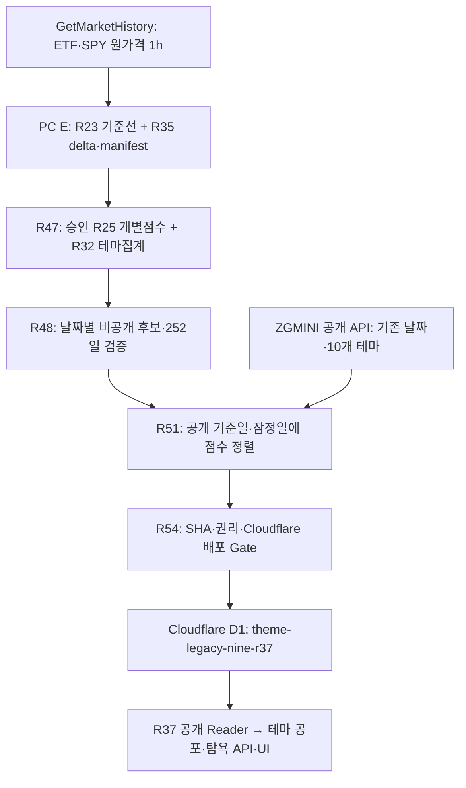

# 기존 9개 테마 R32 — 실제 수집·계산·잠정치·게시 구조 정본

- 마지막 확인: **2026-10-29 KST**, R56/R57/R55 실PC 로그 + 공개 API + 소스 API 응답 기준.
- 저장소 `ansqhd5774-Choi/zgmini`; **작업 전용 브랜치** `codex/theme-fear-greed-integration-20261025`.
- 목적: 우주·위성 연구로 검증한 **승인 R32 산식을 다시 만들지 않고**, 기존 9개 테마의 실자료 자동 갱신과 기존 공개 10개 중 교집합 8개의 확정·잠정치 게시를 완성한다. 미공개 **AI·반도체**는 자동으로 공개하지 않는다.
- **이 문서가 2026-10-29 현재 운영 아키텍처·API 역할·실제 미완료 게이트의 기준**이다. 과거 R39~R46 문서는 당시 실측 이력이며 그 당시의 `NEXT` 문구를 현재 지시로 재사용하지 않는다.

## 1. 실제 구성과 책임

| 책임 | 기존 실제 코드 | 입력·결과 | 실행 위치 |
| --- | --- | --- | --- |
| 원가격 증분 수집 | `scripts/pc-writer/theme-nine-r35-delta-collect.mjs`, `theme-nine-r47-recurring-private-refresh.mjs` | 승인 63 ETF + SPY(고유 64심볼), 원본 JSONL, SHA 매니페스트, NY일별 체크포인트 | PC `E:\ZGmini\data\themes\legacy-nine-r35-delta` |
| 개별/집계 점수 | `theme-nine-r47-recurring-private-update.mjs`, `theme-nine-r47-private-score.mjs`, `theme-nine-r47-private-theme-aggregate.mjs` | 기존 R25 개별점수, R32 승인 AUM 가중, 비공개 `_ETF.json`/`_NINE.json` | PC `legacy-nine-r47-private` |
| 252일 후보 | `theme-nine-r48-r47-bridge.mjs`, `theme-nine-r48-stage-current.mjs` | 저장된 비공개 쌍을 재검증해 날짜별 R48 후보 저장 | PC `legacy-nine-r48-private-candidate` |
| 확정·잠정 날짜 정렬 | `theme-nine-r51-stage-current.mjs`, `theme-nine-r51-provisional-overlay.mjs` | 현재 공개의 확정일·잠정일에 같은 산식으로 계산된 R48 날짜를 정렬, 증명할 수 없는 날은 WAIT | PC `legacy-nine-r51-private-provisional` |
| D1 공개 게시 | `theme-nine-r54-public-connect.mjs`, `theme-nine-r54-d1-client.mjs`, `theme-nine-r48-d1-publication.mjs` | 원본 재현·권리동의·배포 확인 후 CAS 쓰기·D1 readback | PC → Cloudflare D1 |
| 공개 읽기 | `worker/theme-nine-r37-public.mjs` | **기존 10개 순서/기존 우주·데이터센터 이력 보존**, 겹침 8개에 한해 R32 점수 연결 | Cloudflare Worker |

## 2. API 전체 목록 — '등록'과 '실제로 쓰는 것' 분리

| API/서비스 | 해당 작업의 실제 역할 | 2026-10-29 R32 현황 |
| --- | --- | --- |
| `getmarkethistory.com/api/v1/bars/stocks/{symbol}/1h` | **ETF 원가격 수집 API ①**, 1시간봉 raw/unadjusted, SPY 비교 기준 | **R47 실제 활성 원천 1개**. R56 종료 창에서는 `providerCalls=0`(재조회하지 않음). 직접 2026-10-27 SPY 요청 시 `x-row-count:0`, `x-data-through:2026-10-26T23:59:00Z` |
| `marketparquet.com/api/v1` | **보조 ETF 가격 API ②**, 일봉 split-adjusted·역사 backfill R46; R45는 기존 정규 Parquet를 **재사용만** 함 | **R32 원가격 계산에 미연결.** R45 실PC 7일/최신 54/63개 ETF 저장 확인, R46 무료 인증 미확인. R32 원가격 1h와 동등성 검증 없이 혼합 금지 |
| `zgmini.kr/api/theme-fear-greed/` | 기존 공개 **10개 테마, 확정/잠정 날짜**를 R51/R54가 읽고 결과 재조회 | 날짜 기준/검증용. 원가격 공급자가 아님 |
| `api.github.com`, `raw.githubusercontent.com` | R54가 PC 승인 공개 Reader와 최신 `main` 내용을 대조 | 배포 출처 Gate 전용. 원가격 공급자가 아님 |
| `api.cloudflare.com/client/v4/.../d1/database/.../query` | 승인된 R37 key에 파생 점수 저장/재조회 | **게시 전용**, R51 정렬 Gate 통과 후에만 쓰기 |

**정확한 개수:** (1) 현재 R32 **원가격 수집에 사용 중인 외부 제공처는 1개**(GetMarketHistory); (2) 조사·저장·백필 경로로 **확보한 ETF 원천은 2개**(GetMarketHistory/MarketParquet); (3) 가격·공개 날짜·배포 검증·D1 입출력을 포함해 R32 자동 게시 코드에 등장하는 **운영 API 서비스는 4개**(GetMarketHistory/ZGMINI/GitHub/Cloudflare). MarketParquet는 현재 자동 게시 계산 경로에 **포함하지 않는다**. 한 번의 실행에서 API 호출 수와 연결된 서비스 개수도 혼동하지 않는다.

## 3. 산식·로스터·데이터 모드 — 변경 금지

- 이미 승인된 R32의 **추세 40 / SPY 상대강도 20 / 변동성 40**, 날짜별 발행사 AUM, 유효 ETF 수에 따른 승인 분기를 **재연구·재정의하지 않는다**.
- 기존 연구 9개 / ETF **고유 63종·편입 64자리**; 공개 교집합 8개, AI·반도체 연구 테마는 별도 미공개.
- 기존 R23 1h 원가격 기준선 및 실PC 9×252=2,268점, R33 겹침 8×252=2,016점 연구 실증은 보존.
- MarketParquet `split-adjusted EOD`는 GetMarketHistory `RAW_UNADJUSTED_1H_NOT_OFFICIAL_CLOSE`와 가격 모드가 다르다. **같은 종목·날짜에 파일이 있다는 사실만으로 가격 일치 또는 승인된 대체 입력이라 판단하지 않는다.**
- 불확실한 값·결측값을 0·전일값·사이트 구버전 점수로 채우거나 최신 거래일로 위장하지 않는다.

## 4. Windows 자동 운영·PC 소스 설치·게시 경로

| 구분 | 실제 역할/상태 |
| --- | --- |
| R47 수집기 | `E:\ZGmini\data\pc-writer\theme-nine-r48\THEME_NINE_R47_RECURRING_PRIVATE_UPDATE.cmd`. R57 설치 검증 성공. 신 SHA `5a2149556ab4ebc255ea54a14501d1511a906a2904252cad938f9de0b730a24c`, 구버전 `.R57_BACKUP` 보존 |
| R48 정규 작업 | `ZGMINI-PC-Theme-Nine-R47-Private`, 현지 PC 매일 **11:30** 예약 설계. 기존 R48 CMD가 R47 → R48 후보 저장 실행 |
| R54 정규 작업 | `ZGMINI-PC-Theme-Nine-R54-Public`, 현지 PC 매일 **13:30** 예약 설계. 원본·권리·배포·정렬 Gate 통과 시 D1 쓰기 |
| R55 수동 통합 실행 | 기존 `THEME_NINE_R55_PUBLISH_NOW.cmd`: R48/R54를 호출하고 공개 API를 읽는다. **R48_EXIT=0, R54_EXIT=0만으로 D1 게시 성공 아님** |
| R56 진단 | 이미 설치된 R48/R54 내부 실행 로그와 상태 JSON을 모아 실제 `WAIT/STOP/PUBLISHED`의 첫 원인을 확인 |

## 5. 실제 실행 증거와 현재 처음 실패하는 Gate (2026-10-29)

1. **PC 설치 PASS:** R57 로그 `R57_R47_PLANNER_UPGRADED_SHA_VERIFIED`, 신 SHA 일치 및 백업 생성. 산식·로스터·DB·작업 변경 0.
2. **PC 실행 시도 PASS / 게시 미완료:** R55 실행 `R48_EXIT=0`, `R54_EXIT=0`이지만 공개 검증은 `publicR32Verified=false`. R56의 R47은 `WAIT_WINDOW_ALREADY_CHECKED`, `lastVerifiedSpyNYDay=2026-10-26`, `providerCalls=0`; R51은 `WAIT_R48_ALIGNED_SNAPSHOTS`, `missing=LATEST_PROVISIONAL(2026-10-27)`; R54는 **`d1Writes=0`, `publicWrites=0`**.
3. **공개 API 실측:** `status=READY`, `modelRevision=null`, `methodologyVersion=ETF_ONLY_T40_R20_V40_PAIR50`, 확정일 2026-10-26, 잠정일 26·27, 기존 공개 10개 유지. 화면에 보이는 **10월 27일 기존 잠정치**와 **새 R32 10월 27일 ETF 계산값**은 다른 데이터다.
4. **원천 데이터 지연 확인:** 10월 27일 SPY 1h 직접 GET은 HTTP 200이지만 `x-row-count:0`, `x-data-through:2026-10-26T23:59:00Z`. 이는 **해당 제공처에서 그 시점에 27일 값이 없다는 증거**이지 모든 가격 API에서 수집 불가능하다는 증거가 아니다.
5. **Cloudflare Git 운영 빌드 PASS(소스 배포):** `main` 커밋 `74dc2024719a527d473f249702bdd53b5f3dcbac`의 `Workers Builds: zgmini-migration-candidate-r5` 성공, 운영 build `af7548ac-9f2f-4e9f-8d64-796bd43ff681`, R37 Reader main/local 일치. **Cloudflare 빌드 성공은 R37 D1 점수 게시를 의미하지 않는다.**

**현재 종료 판정:** `PC_R57_INSTALLED / R48_R54_INVOKED / CLOUDFLARE_SOURCE_BUILD_PASS / R51_2026_10_27_UNALIGNED / D1_R32_NOT_PUBLISHED`.

**R58 추가 검사(2026-10-29):** 기존 가격 원천은 재조회에서도 SPY 27일 1h 행 0건(`x-data-through:2026-10-26T23:59:00Z`), 공개 API는 아직 `modelRevision=null`. PC가 이미 사용 중인 Alpaca의 무료 IEX/SIP 1h `adjustment=raw` 가능 여부를 SPY 한 종목·최대 3GET로 확인하는 [R58 읽기 전용 검사](THEME_NINE_R58_ALPACA_SOURCE_RECOVERY_20261029.md)를 **같은 브랜치에 코드·Windows CMD·테스트와 함께 저장**했다. R58은 소스 대체 승인이나 실제 D1 게시가 아니며, 27일 원가격이 검증될 때만 기존 R47→R54 경로를 재개한다. 최신값은 실행 직전 다시 확인한다.

## 6. 다음 작업의 정확한 초점

- **신규 산식·ETF 선정·9×252 연구 재실행이 아니다.** 기존 9개 R32 게시의 첫 차단점은 R51이 요구하는 날짜(27일)에 해당하는 저장된 R48 원가격 계산 후보의 부재다.
- 이미 등록한 MarketParquet 및 PC 저장자료가 27일 63종 ETF에 **실제로 같은 가격 모드로 유효한지 읽기 전용 증명**하고, 맞는 경우에만 승인 수집 경로에 연결한다. 미확인 유료/제3자 소스 사용 또는 가격모드 혼합은 별도 승인 없이는 하지 않는다.
- 기존 제공처의 27일 값이 도착하면 R47 증분 원본→R48 후보→R51 날짜 정렬→R54 D1 readback→공개 API `modelRevision=THEME_LEGACY_NINE_R37_PUBLIC_V1`까지 **실제 게시 실행으로 완결**한다.
- 사용자는 **배포 이후 거래일별 운영 결과를 모니터링**한다. 사용자의 모니터링 약속을 이유로 **초기 D1 게시를 건너뛰거나, 예약 작업 설치만으로 완료**라고 보고하지 않는다.
- 산식 변경·비공개 연구 9개와 공개 교집합 8개의 혼동·공개 10개 삭제·예전 점수 최신으로 복제·임의 Git 브랜치 생성/교체·다른 프로젝트 코드와의 혼합 금지.

## 7. 기준 문서·로그·공식 API

- 상위 목표: [163 테마 최상위 계획](THEME_FEAR_GREED_163_THEME_MASTER_PLAN_20261027.md). 실PC 증거·해시: [R57 closed-NY 수정](THEME_NINE_R57_NY_CLOSED_SESSION_REPAIR_20261029.md); 게시 계약: [R54 D1 연결](THEME_NINE_R54_PUBLIC_D1_CONNECT_20261028.md).
- 실제 로그 식별: `THEME_NINE_R56_EXISTING_LOGS_4924_26306.txt`, `THEME_NINE_R57_CLOSED_NY_FIX_RESULT_7360_16457.txt`, `THEME_NINE_R55_PUBLISH_NOW_RESULT_7399_14366.txt` (사용자 실PC 전달, Git 원가격/키 저장 금지).
- GetMarketHistory: https://getmarkethistory.com/docs/api/reference; MarketParquet: https://marketparquet.com/documentation; Cloudflare Git 운영 빌드: https://developers.cloudflare.com/workers/ci-cd/builds/git-integration/github-integration/.

> 이 기준서는 **현재 구조와 실증 상태의 인수인계 문서**다. 게시 실행·D1 쓰기 자체를 대신하지 않으며, 이후 R48/R54 로그의 첫 실패 원인만 이어서 해결한다.
