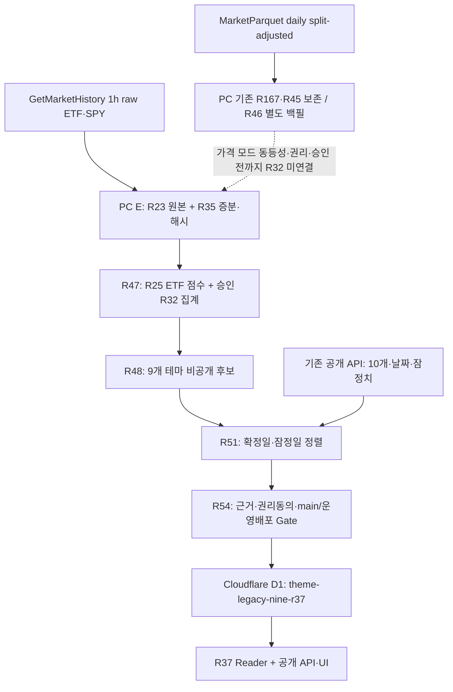

# 기존 9개 테마 R32 — 가격 API 2종·자동 갱신·D1 게시·공개 Reader 전체 인수인계

- 작성·근거 기준: 2026-10-29 KST. 당시 수집기 코드 및 사용자 실PC R55/R56/R57/R62 결과를 대조한 상태 기록이다. 이후 운영 상태는 반드시 재조회한다.
- 저장소: `ansqhd5774-Choi/zgmini`; **기존 전용 개발 브랜치**: `codex/theme-fear-greed-integration-20261025`.
- 범위: 기존 연구 9개 테마의 R32 신규 계산 결과를 기존 공개 10개 테마 중 교집합 8개에 안전하게 반영. 연구 AI·반도체를 임의로 추가 공개하지 않음.
- 산식/ETF/DB/작업 등록/배포 변경: **이 문서 자체는 0건**. 이 문서는 연결·운영 계약과 현재 장애를 남기며 실행 완료를 주장하지 않는다.

## 1. 가장 중요한 결론

1. ETF 가격 제공 API는 **GetMarketHistory와 MarketParquet 2종**이다. 그러나 현재 **R32의 실제 계산에 투입되는 API는 GetMarketHistory 1종**이다. MarketParquet는 기존 정규 파케이 수집 및 별도 R45/R46 조사·백필 경로이고 R32 대체 입력으로 연결되지 않았다.
2. GetMarketHistory는 공식적으로 **최신 주식·ETF 시장봉 약 48시간 지연** 공급이다. 따라서 2026-10-29 조회 당시 10월 27~28일 관측봉이 없을 수 있으며, 이는 예약 작업 장애와 구별해야 한다.
3. MarketParquet `etf_daily`는 **장 마감 후 일별 갱신**을 안내한다. 이를 ‘정확히 24시간 고정 지연’으로 단정하지 않는다. 계정·권한·실제 파일 날짜와 출처 모드 검증이 필요하다.
4. PC는 **11:30 KST 수집·비공개 후보**, **13:30 KST 별도 공개 게시 시도**로 연결한다. 두 작업은 한 작업이 아니며, 첫 작업만 성공해도 D1과 사이트는 자동으로 변하지 않는다.
5. 초기 R55/R56에는 `WAIT_R48_ALIGNED_SNAPSHOTS`, D1 쓰기 0회가 있었다. 그러나 **더 나중의 R62 실PC 읽기 전용 결과에는 승인 D1 레코드가 이미 존재**한다. 같은 기록을 구분하지 않고 ‘D1에 한 번도 저장되지 않았다’고 보고하면 잘못이다.
6. R62 당시 **레코드는 Reader 자체의 적합성 검사에 통과**(`eligibleInSameReader=true`)했으나 실제 공개 API의 `modelRevision=null`이다. 현재 **첫 미해결 지점은 D1 원장 자체보다 운영 API의 Reader 적용·실제 D1 바인딩·배포본의 연결 여부**다. 정확한 근본 원인은 아직 단정할 수 없다.

## 2. 전체 데이터 흐름과 운영 책임



| 구성 | 저장/실행 프로그램 | 운영 기능 | 게시 여부 |
| --- | --- | --- | --- |
| R23/R35 | `theme-nine-r35-delta-collect.mjs`, `theme-nine-r47-recurring-private-refresh.mjs` | 63 고유 ETF+SPY(총 64심볼)의 무보정 1h 원본·SHA·체크포인트 | 비공개 |
| R47 | `theme-nine-r47-recurring-private-update.mjs`, `theme-nine-r47-private-score.mjs`, `theme-nine-r47-private-theme-aggregate.mjs` | R25 개별점수와 R32 테마 집계, 기존 9×252 실증 보존 | 비공개 |
| R48 | `theme-nine-r48-stage-current.mjs`, `theme-nine-r48-r47-bridge.mjs` | 원본 쌍·로스터/AUM·날짜·해시 검증 후 후보 생성 | 비공개 |
| R51 | `theme-nine-r51-stage-current.mjs`, `theme-nine-r51-provisional-overlay.mjs` | 공개 기준 확정일·잠정일과 후보 정렬 | 비공개 |
| R54 | `theme-nine-r54-public-connect.mjs`, `theme-nine-r54-d1-client.mjs`, `theme-nine-r48-d1-publication.mjs` | 게시 동의·출처·main/배포 Gate, R37 키 CAS·readback | 조건부 D1 게시 |
| R37 Reader | `worker/theme-nine-r37-public.mjs`, `worker/theme-etf-only-public.mjs`, `app/api/theme-fear-greed/route.ts` | 기존 10개 순서·이력 유지, 교집합 8개 R32 반영 | 공개 읽기 |

## 3. 각 가격 API의 실제 연결·지연·작업 방법

### API ① GetMarketHistory — 현재 R32 활성 원가격

- 실제 URL 형식: `GET https://getmarkethistory.com/api/v1/bars/stocks/{SYMBOL}/1h`.
- `RAW_UNADJUSTED_1H_NOT_OFFICIAL_CLOSE`. NY 거래일의 기존 승인 시각별 관측봉을 취급하며 **공식 거래소 종가가 아니다**.
- 공급자 최신성: 공식 Coverage의 미국 주식/ETF 48시간 규칙. **48시간 후 데이터 확보 보장**이 아니라 늦게 도착할 수 있는 관측 가용성 조건으로 취급한다.
- 2026-10-29 실측 예: SPY의 27일 요청은 HTTP 200이지만 `x-row-count=0`, `x-data-through=2026-10-26T23:59:00Z`. **HTTP 200과 실제 관측 성공을 구분**한다.
- 수집: PC R47 → R35 증분. 승인 주기에서 과도한 API 호출을 막기 위해 최대 4 GET/배치·60초 간격·최대 64배치 계약 보존. 동일 창 확인 완료 시 `WAIT_WINDOW_ALREADY_CHECKED`와 `providerCalls=0`은 새 관측을 입증하지 않는다.
- 저장: `E:\ZGmini\data\themes\legacy-nine-r23`, `legacy-nine-r35-delta`, `legacy-nine-r47-private` 안의 승인된 데이터, 원본 SHA·manifest·관측일을 유지한다.
- R57 수정: 마지막 미국장 마감 이후를 검토하도록 R47 플래너의 NY 종료 임계값을 **NY 19:00**으로 변경. 이는 **장 마감 관측 날짜 계산 문제**만 수정하고 공급원 48시간 지연은 해결하지 않는다. 사용자 실PC 설치 SHA `5a2149556ab4ebc255ea54a14501d1511a906a2904252cad938f9de0b730a24c` 검증됨.

### API ② MarketParquet — 독립 EOD·백필, R32 미연결

- 공식 API 대표 경로: `GET https://marketparquet.com/api/v1/manifest/etf_daily?start={YYYY-MM-DD}&end={YYYY-MM-DD}`. 계정·엔드포인트 권리·가용성은 공식 문서에 따른다.
- 가격 모드: `DAILY_SPLIT_ADJUSTED`(분할 조정된 일봉). GetMarketHistory의 무보정 1h 입력과 **동일한 값이나 동일한 산식 입력이라고 간주하지 않는다**.
- 기존 Windows 정규 작업: `ZGMINI-PC-MarketParquet-ETF` → `E:\ZGmini\data\theme-market-history-r131\marketparquet-r167\r167-cycle.mjs`. 전체 일별 ETF 파케이 원본을 받지만 기존 7개용 파생 입력은 **고정 14심볼**로 운영 중이다. 기존 R167/R181/R171과 해당 예약 작업을 63심볼로 임의 수정하지 않는다.
- R45는 저장된 원본 Parquet를 별도로 읽어서 R20 승인 63 ETF+SPY와 대조한다. 실PC 7거래일(10/16, 19, 20, 21, 22, 23, 26) 추출, 최신 54/63 ETF 및 SPY 확인; 9종 부재(`CABZ,CBOT,GNMX,KYC,LATR,LLMA,RBTX,WR,XA`), 40일 이상 자료 0종.
- R46 `THEME_NINE_R46_FREE_EOD_BACKFILL.cmd`는 공식 무료 기간(약 1년)의 승인 경로로 360일 자료를 추가 수집하는 **별도 작업**이다. 실PC 결과 `R46_FREE_SAMPLE_ACCOUNT_ACCESS_REQUIRED`, HTTP 401은 **인증/권한 미확인**이지 63 ETF가 존재하지 않는다는 뜻이 아니다.
- 정규 무료 계정 키를 사용자가 본인 PC CMD 환경변수 `MARKETPARQUET_API_KEY`로 제공하는 경우에만 권한 내에서 재시도한다. **키·원자료를 Git/로그/대화에 기록하지 않으며 인증 우회·유료 구독 전환 금지**.
- 데이터가 확보되어도 `R32`에 자동 합산하지 않는다. 동일 ETF·날짜의 가격·시간·조정 방식·전 종목 커버리지·재현 결과·이용 권리·사용자 승인 **전부 확인**해야 소스 전환을 별도 구현할 수 있다.

### API ③~⑤: 가격 공급자가 아니라 공개 운영 연결

| 서비스 | 용도 | 작업 단계 |
| --- | --- | --- |
| `https://zgmini.kr/api/theme-fear-greed/` | 기존 공개 10개 순서, 확정일·잠정일, 실제 R32 노출 여부 조회 | R51 날짜 정렬; R54 게시 전후 검증; R55/R62 진단 |
| `api.github.com`, `raw.githubusercontent.com` | 기존 승인 Reader 원본과 최신 GitHub `main` 비교 | R54 배포 권한 검증 |
| `api.cloudflare.com/client/v4/accounts/{account}/d1/database/{db}/query` | 승인된 `public_feed_snapshots_v1` / `theme-legacy-nine-r37` 키의 CAS 쓰기·readback | R54 D1 게시 및 R62 읽기 전용 점검 |

## 4. Windows CMD 자동 갱신: 설치/스케줄/실행 원리

| 순서 | 기존 Windows 작업 이름 | 한국시간 | 실행 대상 | 성공의 정확한 의미 |
| --- | --- | --- | --- | --- |
| 1 | `ZGMINI-PC-Theme-Nine-R47-Private` | 매일 **11:30** | `E:\ZGmini\data\pc-writer\theme-nine-r48\THEME_NINE_R48_PRIVATE_CYCLE.cmd` | R47 원자료 수집·계산 → R48 비공개 후보 저장. **D1 쓰기 0** |
| 2 | `ZGMINI-PC-Theme-Nine-R54-Public` | 매일 **13:30** | 설치된 `THEME_NINE_R54_PUBLIC_CYCLE.cmd` | 기존 R48/R51과 배포·동의 Gate 통과할 때만 D1 게시·readback·공개 API 확인 |

- R48 예약 설치 프로그램: `scripts/pc-writer/theme-nine-r48-private-schedule.mjs --inspect` (읽기만) 또는 `--install` (사용자 승인으로 최초 설치). 실제 예약은 Windows `schtasks`의 사용자 **InteractiveToken**, `IgnoreNew`, `StartWhenAvailable` 방식이다. 이미 등록된 작업은 강제 덮어쓰지 않는다.
- 간편 기존 설치/수리: `THEME_NINE_R49_ONE_CLICK_PRIVATE_AUTO_INSTALL.cmd`, `THEME_NINE_R50_REPAIR_PRIVATE_TASK.cmd`. 기존 설치 증거가 있다면 불필요하게 재설치하지 않는다.
- R54 게시기 최초 연결: `THEME_NINE_R54_PUBLIC_CONNECT.cmd`. 인증·배포·해시 확인, 본인 PC에서의 권리 위험 동의(`PUBLISHER_CONSENT_R54.txt`) 후에만 별도 예약 작업 생성/게시 시도. R54 주기 CMD는 가격 API 호출을 하지 않는다.
- R55 수동 단일 확인: `THEME_NINE_R55_PUBLISH_NOW.cmd`. 기존 R48 실행 → R54 실행 → live API 검증. **`R48_EXIT=0`, `R54_EXIT=0`만으로 최종 성공이 아니다.** `RESULT=PUBLIC_R32_LIVE_VERIFIED`, `publicR32Verified=true`, 공개 `modelRevision` 확인이 필요하다.
- R56 기존 로그 점검: `THEME_NINE_R56_EXISTING_LOGS.cmd`. R62 더 최신 D1/Reader 조사: `THEME_NINE_R62_READONLY_DIAGNOSE.cmd`(읽기 전용; D1 저장/수정 0).
- 운영에는 PC 켜짐, 사용자 로그인 세션, E: 접근, Node·네트워크가 필요하다. 창을 열어두거나 RDC를 연결할 필요는 없다. PC의 작업 실행 시각과 실제 원천 API 관측 가능 시각은 별개다.

### CMD에서 확인하는 최소 읽기 전용 절차

작업이 **이미 설치된 PC**의 Windows **명령 프롬프트(CMD)**에서 다음을 각각 실행한다. 새로운 설치·강제 실행·기존 원장 수정은 이 조회로 발생하지 않는다.

```cmd
schtasks /Query /TN "ZGMINI-PC-Theme-Nine-R47-Private" /V /FO LIST
schtasks /Query /TN "ZGMINI-PC-Theme-Nine-R54-Public" /V /FO LIST
```

개별 `.cmd`의 실파일 위치와 설치된 모듈 SHA가 일치하는지 확인하고, 로그의 **첫 WAIT/STOP 원인**과 D1 readback 결과를 분리해 기록한다. `schtasks`가 보인다고 실제 데이터 수집·게시 성공인 것은 아니다.

## 5. 확정·잠정치 일치 계약

- R51의 현재 기본값은 `provisionalMode='PUBLIC_LEGACY_AS_IS'`. 이는 **공개된 기존 10/26·10/27 잠정 데이터 날짜·점수**를 변경하지 않고 R32 **확정 이력**만 승인된 대로 합성한다. 기존 잠정치를 새로운 R32 잠정 계산으로 허위 표시하지 않는다.
- 선택 모드 `R32_DATED`는 모든 공개 잠정일에 대응하는 **동일 R32 산식의 날짜별 실점수**가 저장되고 사용자 승인·게이트를 거친 후에만 가능하다. GetMarketHistory 48시간 지연 중에는 최신 잠정일의 같은 날 점수가 자연스럽게 없을 수 있다.
- 2026-10-29 당시 확인한 공개 확정일은 `2026-10-26`, 공개 잠정 날짜는 `2026-10-26` 및 `2026-10-27`. **공개된 잠정일이 있다는 사실과 R32 ETF 관측봉이 확보됐다는 사실을 혼동하지 않는다**.
- R51 결과가 `WAIT_R48_ALIGNED_SNAPSHOTS`이면 D1 게시를 억지로 진행하지 않는다. 반면 공개 구버전 잠정치 보존 모드에서는 10/27 R32 확정 후보가 없더라도 승인된 10/26 anchor가 있으면 별도 동작이 가능하다. 실제 모드/소스 SHA로 판정한다.

## 6. R55/R56 → R62 최신 진단: 실패 지점 변화

| 근거 | 당시 실제 상태 | 정확한 해석 |
| --- | --- | --- |
| R56 초기 실행 | `lastVerifiedSpyNYDay=2026-10-26`; `WAIT_WINDOW_ALREADY_CHECKED`; `providerCalls=0` | R47이 27일 새 관측을 다시 요청하지 않은 창이 있었음 |
| R55/R56 초기 게시 | `WAIT_R48_ALIGNED_SNAPSHOTS`, `d1Writes=0`, `publicWrites=0`, `publicR32Verified=false` | **당시 그 실행에서는** 새 R32 D1 게시가 발생하지 않음 |
| R62 **이후** D1 직접 조회 | `databaseMatchesApproved=true`, `recordVersion=THEME_LEGACY_NINE_R37_PUBLIC_V1`, `recordDate=2026-10-26`, `recordPhase=PROVISIONAL` | 승인 DB에 R37 현재 레코드가 **이미 존재**함. R62 자기 자신의 D1 쓰기는 0회 |
| R62 공개 API | `publicVersion=THEME_ETF_ONLY_R144_252_PUBLIC_V1`, `publicModelRevision=null`; 확정 10/26, 잠정 10/26·10/27 | 저장된 R37 결과가 공개 응답에 아직 합성되지 않음 |
| R62 코드 검증 | `eligibleInSameReader=true`, 원본·이력·날짜·권리위험 고지·신선도 Gate 대부분 true | **동일 Reader 논리에서 레코드가 적합**함. 그러나 실제 운영 Reader/DB 경로는 불일치 가능 |
| R62 유일 false 항목 | `recordRightsConfirmed=false`, `recordRightsRiskDisclosure=true` | 발행자의 **미확인 권리 위험 명시 수락** 경로. 이것만으로 공개 Reader 미적용 원인이라고 단정하면 안 됨 |

R62 최종 기록: **`D1_RECORD_VALID_BUT_PUBLIC_ROUTE_NOT_APPLYING_READER`**. 로그 이름 `THEME_NINE_R62_READONLY_DIAGNOSE_RESULT_31463_19116.txt` (사용자 실PC 결과; Git에 원본 인증·D1 기록 본문을 저장하지 않음).

### 다음 최소 진단 순서(수정/배포 승인과 별개)

1. 운영 URL `https://zgmini.kr/api/theme-fear-greed/?nonce=...`의 `modelRevision`·확정일·잠정일·테마 수를 캐시 우회로 재조회한다. 이전 R62 스냅샷만으로 현재 장애를 확정하지 않는다.
2. Cloudflare **실제 Production exact deployment SHA**, Workers Git Integration의 연결 저장소/브랜치(`main`), 실제 API route와 호출 Worker, `DB_CORE`/`DB` D1 binding의 **실제 DB ID**를 읽기 전용 조회한다. GitHub `main` 소스와 같다는 사실만으로 운영 배포 일치를 추정하지 않는다.
3. `app/api/theme-fear-greed/route.ts`의 `readThemeEtfOnly(runtime.DB_CORE ?? runtime.DB)`가 실제 운영 bundle에 반영됐는지 확인한다. 실제 DB가 일치한다면 `worker/theme-etf-only-public.mjs`에서 `addVerifiedNineR37`의 적용 순서·실행 에러·요청 시간·캐시를 확인한다.
4. 로컬 보호 테스트 `tests/theme-nine-r63-public-d1-binding.test.mjs`, `tests/theme-nine-r65-public-sidecar-order.test.mjs`, `tests/theme-nine-r37-public-reader.test.mjs`를 실행한다. 테스트 통과는 **운영 배포 검증의 대체물이 아니다**.
5. **근본 원인을 한곳으로 좁힌 후** 해당 파일만 기존 전용 브랜치에서 수정·검증하고 필요한 변경만 `main`으로 반영한다. Cloudflare Git 연동 자동 빌드의 **정확한 commit·배포 ID**와 공개 API·D1 readback을 확인한다. 직접 Wrangler 운영 배포, 통째 branch merge, 원자료 재가공, 임의 권리 검증 플래그 변경은 금지다.

## 7. 완료 판정·오류별 처리

| 상태 | 조치·증거 |
| --- | --- |
| `SOURCE_NOT_AVAILABLE` 또는 SPY row 0 | API 정상 HTTP와 데이터 존재를 분리; 새 날짜 원본 대기/다음 주기 검증. 전일값 복제·0점 삽입 금지 |
| `WAIT_WINDOW_ALREADY_CHECKED` | R57 플래너 SHA·NY 19시 cutoff·체크포인트 확인. 이미 확인된 창의 0 호출만으로 수집 성공 표시 금지 |
| `WAIT_R48_ALIGNED_SNAPSHOTS` | R51 실제 `provisionalMode`, 공개 확정 anchor 및 R48 후보 날짜·SHA 비교 |
| `D1_VERIFIED_AWAIT_PUBLIC_API_REFRESH` | 새 게시를 중복 실행하기 전에 D1 readback·운영 Reader·캐시/배포 확인 |
| `D1_RECORD_VALID_BUT_PUBLIC_ROUTE_NOT_APPLYING_READER` | R62처럼 D1 존재·Reader 논리 적합이면 **route, 실제 D1 binding, 번들/Cloudflare 배포**부터 읽기 전용 진단 |
| `PUBLIC_API_VERIFIED` 또는 `PUBLIC_R32_LIVE_VERIFIED` | `modelRevision=THEME_LEGACY_NINE_R37_PUBLIC_V1`, 기존 10개/252일/잠정치·점수 정합 + 실제 D1 readback + exact deployment 통과한 경우에만 완료 |

**최종 운영 성공의 조건**: 원천 날짜별 재수집 및 저장 → 승인 산식 9개 계산 → 기존 10개 중 8개 공개 연결 → D1 CAS/write/readback → 공개 API R32 모델 revision·날짜·점수 확인 → 다음 자동 주기까지 검증. 이 중 하나라도 빠지면 **설치 완료 또는 일부 연결**로만 보고한다.

## 8. 변경 금지·보존·근거 링크

- 승인 R32 추세 40% / SPY 상대강도 20% / 변동성 40%, R25 개별 점수, 63종 ETF/64 편입자리, 기존 10개 순서와 이력, AI·반도체 미공개 상태 유지.
- `R23/R35` 1h 원본과 `R45/R46` EOD 파케이 **혼합 금지**; Git에는 원자료·계정 키·D1 토큰 저장 금지.
- 예약 작업 강제 재등록, 기존 7개 ETF 정규 파생 계산기 변경, 파일 overwrite, DB 키 재생성, 새 브랜치 생성 금지.
- 공식 출처: [GetMarketHistory Coverage — 48시간 지연](https://getmarkethistory.com/docs/coverage), [GetMarketHistory API](https://getmarkethistory.com/docs/api/reference), [GetMarketHistory 약관](https://getmarkethistory.com/docs/terms), [MarketParquet 데이터 갱신](https://marketparquet.com/data/etfs), [MarketParquet API 문서](https://marketparquet.com/documentation), [Cloudflare Workers Git 연동](https://developers.cloudflare.com/workers/ci-cd/builds/git-integration/github-integration/), [Windows `schtasks` 공식 문서](https://learn.microsoft.com/en-us/windows-server/administration/windows-commands/schtasks).
- 기존 레포 기준 문서: `docs/THEME_FEAR_GREED_163_THEME_MASTER_PLAN_20261027.md`, `docs/THEME_NINE_LIVE_ARCHITECTURE.md`, `docs/THEME_NINE_R47_RECURRING_PRIVATE_UPDATE_20261028.md`, `docs/THEME_NINE_R48_AUTOMATIC_PUBLICATION_BRIDGE_20261028.md`, `docs/THEME_NINE_R51_R52_PROVISIONAL_SCORE_CONNECTION_20261028.md`, `docs/THEME_NINE_R54_PUBLIC_D1_CONNECT_20261028.md`, `docs/THEME_NINE_R57_NY_CLOSED_SESSION_REPAIR_20261029.md`.

> **인수인계의 현재 미완료 지점(2026-10-29 R62)**: R37 D1 기록의 존재와 내부 적합성은 확인했지만, 공개 API는 아직 구모델이다. 다음 작업은 **실제 운영 route·D1 binding·Cloudflare exact 배포의 불일치 원인 확인**이며, 이 문서 저장 자체를 사이트 반영 또는 자동 갱신 성공으로 표기하지 않는다.
