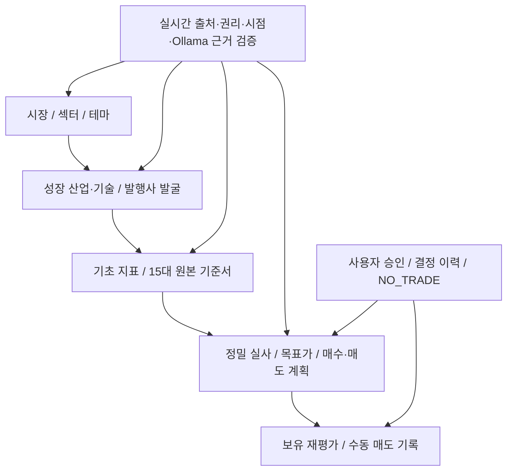
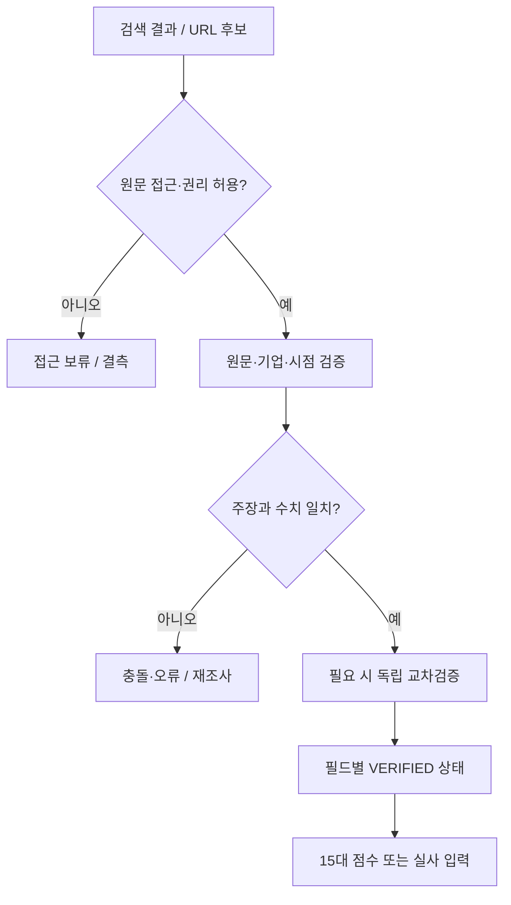

# 개인 투자 프로세스 프로그램 정밀 구현 계획서

> **문서 버전:** 정량 평가 통합 개정안 R2.0 (원문 전체 보존·개정)  
> **작성 기준:** 2026-10-25 (한국시간)  
> **대상:** 개인 장기투자용 시장 선행형 투자 의사결정 시스템  
> **상태:** **전 15단계 설계본 / 04단계 새 가중치 실측·운영 승인 전 / 매매 자동화 승인 없음**  
> **핵심:** 시장 → 섹터 → 테마 → 산업·기술 → 기업 → 15대 기준서 → 정밀 실사 → 목표가 → 분할 매수·매도 → 보유·재평가

> **개정 사항:** 03단계 통과 테마 9개 재심사 금지 / 04단계 정량 순위·주관적 PASS/FAIL 폐기 / 공식 산업 실측자료의 기관·매체 지정 / 기존 ETF 공탐 읽기 전용 / 결측은 실패·0점이 아님 / 기업 수익화 검증은 06~10단계 / 금지 자료의 우회 이용도 제외.

## 0. 목적과 절대 원칙

사용자는 개별 종목을 먼저 검색하지 않는다. **시장 전체의 위험·심리를 판단한 후, 섹터와 테마를 좁히고, 구조적으로 성장하는 산업·기술에서 우수 기업을 찾는다.** 그다음 재무·사업 검증, 사용자가 만든 **15대 PDF 기준서의 독립 점수**, 투자 전 정밀 실사, 목표가 및 분할 거래 계획을 거쳐 매수 여부를 최종 결정한다. 프로그램은 판단의 *근거와 빈틈*을 제시하는 도구이지, 투자자의 승인 없이 거래하는 주체가 아니다.

### 고정 원칙

1. **시장 선행:** 종목 이름을 알고 있어도 1~5단계를 생략하지 않는다. 기존 보유종목 정기 점검은 별도 `HOLDING_REVIEW` 경로로 구분한다.
2. **15대 기준서 보존:** 원본 PDF에 대응하는 기존 계산기의 구성 항목·가중치·결측 처리·버전은 승인 없이 변경하지 않는다. 15개를 단순 평균해 임의의 종합 점수로 만들지 않는다.
3. **새로운 실시간 근거:** 이전 검색 목록·저장 점수·오래된 데이터는 조사 위치와 변화 비교에만 사용한다. 현재 판단은 시점이 확인된 실제 원천에서 재검증한다. 변경 공시가 없어도 검증 시점을 표기한다.
4. **검색 ≠ 사실:** URL 발견, 웹 본문 확보, 정확한 인용, 경제적 의미 검증, 독립 교차확인은 각각 다른 상태다.
5. **결측은 결측:** `NULL`, `NOT_AVAILABLE`, `UNVERIFIED`, `STALE`, `CONFLICT`를 보존한다. 추정 값을 실제 값처럼 제시하지 않는다.
6. **자료 권리:** 원문 수집·재사용·파생 점수·재배포 권한과 호출 정책을 출처별로 조사한다. 가격 자료나 유료 서비스 데이터를 자동 재배포하지 않는다.
7. **의사결정 권한:** 프로그램은 우선 `READ_ONLY / RESEARCH_ONLY / NO_TRADE`. 매매 시뮬레이션과 실제 주문은 분리한다. 주문 API 연결·비밀번호·권한·자동주문은 **별도 명시적 승인**이 있기 전까지 금지한다.
8. **운영 불변:** 기존 ZGMINI, 운영 DB·원장·스케줄러·공급원·가중치·DNS 및 다른 프로젝트를 무단 수정하지 않는다.
9. **기록 재현:** 모든 분석은 기준 시각(한국시간·미국시장시간 구분), 자료 관측일, 발표일, 수집일, 계산 버전, 원본 링크와 상태를 표시한다.
10. **유동성·손실 위험 우선:** 높은 점수와 급락한 심리 지표는 매수 신호와 동의어가 아니다. 목표가는 보장 가격이 아니다.
11. **04단계 고유 역할:** 이미 통과한 ETF의 구성·628거래일 자격·공탐 산식 재검증을 반복하지 않는다. 산업 실물 성장 수치와 공탐의 괴리를 비교한다.
12. **주관적 점수 금지:** '성장 전망 좋음'·'이슈 중요함' 등의 해석과 기자 전망은 PASS/FAIL이나 수치 가산점으로 쓰지 않는다.
13. **금지된 미국 증권 규제당국 자료·우회본 제외:** 직접 포털·원문·API 및 동일 문서의 미러·복제·중계본에 의존하지 않는다. 회사 자체 IR·거래소 고유 정보·산업통계·사용권이 허용된 서비스만 별도 검토한다.

---

## 1. 투자 전 과정: 15단계 확정 작업 흐름

| 단계 | 사용자 의사결정 | 프로그램 조사·연산 | 필수 산출물 | 다음 단계 통과 조건 |
|---|---|---|---|---|
| **01 시장 분석** | 지금 위험을 어느 정도 감수할 수 있는가 | 시장 공포·탐욕, 변동성·추세·시장폭 등 승인된 구성요소와 기간·최신성 확인 | 시장 상태 카드, 1년 추이, 충돌 신호 | 관측일·산식 버전 확인; 불충분하면 보류 |
| **02 섹터 분석** | 어느 섹터로 관심을 좁힐 것인가 | 섹터별 공포·탐욕, 시장 대비 상대강도, 유동성, 구성 ETF의 대표성 | 섹터 비교표·선별 사유 | 비교 가능한 ETF/기간·권리 확인 |
| **03 테마 분석** | 섹터 내부의 어느 테마인가 | 테마 공포·탐욕, ETF 간 중복·커버리지, 1년 추세·결측 검사 | 테마 비교표 | 테마 분류·ETF 증거 검증 |
| **04 매력 테마 선정** | **산업 성장 실측값 대비 테마의 시장 심리가 얼마나 위축되었는가** | 공식 시계열 성장률·가속도 → 0~100 정규화 → 기존 공탐과 괴리 계산 → 정량 매력도 | **원수치·성장률·정량 순위·공탐·괴리·자료충족률·근거** | 주관적 PASS/FAIL·기존 공탐 재검증 금지; 새 가중치 운영 적용은 사용자 승인 후 |
| **05 성장 산업·기술 선정** | 성장의 동력인 기술·산업이 무엇인가 | 산업 매출/수요 성장률, 보급·채택, TAM/SAM, 상용화, 공급 제약, 특허·규제 | 성장 기술 목록·근거·측정 기간 | **ETF 수익률을 산업 성장률로 오인 금지** |
| **06 대표 기업 발굴** | 해당 기술의 경제적 수익을 얻는 상장사는 누구인가 | 사업 노출도·매출 비중·고객·산업 가치사슬·종목 신원 확인 | 기업 후보군 및 제외 이유 | 법인·거래소·티커·주식종류 일치 확인 |
| **07 기업 기본 지표 분석** | 최소 재무 건전성·가치평가가 가능한가 | 매출/이익/현금/부채/희석/밸류에이션/유동성 기초 점검 | 재무 기초표·결측표 | 시점·기간·회계기준·단위 검증 |
| **08 15대 기준서 점수 측정** | 기술·사업·재무의 항목별 객관적 경쟁력은? | 원본 PDF 기준서와 기존 계산기로 각각 독립 평가 | **15개 점수·근거·NULL 이유** | 필수 증거가 부족하면 해당 카드만 미평가 |
| **09 우수 점수 기업 선정** | 어떤 회사를 10단계에 올릴 것인가 | 사용자 승인된 선별 기준, 치명적 결격·품질·분야 적합성 | 실사 대상 최종 후보와 선정 사유 | 임의의 15점수 합산·가중치 도입 금지 |
| **10 매수 매력 정밀 분석** | 이 회사가 실제로 투자할 만한가 | 공매도·현금흐름·경영진·실적·자금조달·사업·기관·기술·뉴스 종합 검증 | 정밀 실사 보고서, 위험 플래그, 반증 목록 | 필수 위험항목 미검증 시 거래판단 보류 |
| **11 목표가 산출** | 가격이 내재 가치에 비해 충분히 매력적인가 | 보수/기준/낙관 시나리오, 기업별 적합 밸류에이션, 희석·순부채 보정 | 목표가 범위·전제·민감도·비대칭 | 출처·가정·산식 공개, 미승인 배수 보류 |
| **12 분할 매수·매도 설계** | 얼마씩 어떤 조건에 들어가고 나올 것인가 | 매수/매도 회차, 조건, 자금 한도, 거래량, 예외·철회 규칙 | 진입/청산 통합 계획표 | 투자자가 가격·비중·조건을 직접 승인 |
| **13 매수 시작** | 실제 첫 회차를 집행할 것인가 | 주문 전 자료·목표가·계획 유효성 점검 및 수동 주문 안내 | 승인 기록, 수동 체결 기록 | 기본 `NO_TRADE`; 별도 명시 승인 없이는 API 주문 없음 |
| **14 보유 및 재평가** | 투자 가설과 목표가가 여전히 유효한가 | 분기 실적·현금·증자·주요 뉴스·시장/테마·기술 변화, 가설 훼손 추적 | 보유 점검표·변경 사유·새 시나리오 | 정기/사건 재평가; 과거 판단 덮어쓰기 금지 |
| **15 분할 매도** | 어느 물량을 왜 매도할 것인가 | 목표가 도달·투자가설 변경·위험 증가·리밸런싱 조건 확인 | 회차별 실현·잔여 물량·매도 사유 | 계획/예외 승인, 체결과 예상 결과 분리 |

### 단계 간 차단 규칙

- `DATA_MISSING`: 해당 필드는 NULL. **04단계에서 자료 부족만으로 테마 자체가 탈락/실패하지 않으며**, 없는 값으로 현재의 정량 순위를 생성할 수도 없다. 매매에 중요한 결측은 후속 단계에서 별도 보류.
- `EVIDENCE_CONFLICT`: 두 근거가 실제로 모순될 때 원인 확인 전 해당 주장·점수 보류.
- `RIGHTS_UNCLEAR`: 자료 접근권과 2차 이용권을 구분해 권한 확인 전 재배포·저장·가공 제공 중단.
- `IDENTITY_MISMATCH`: 회사명과 티커가 같아 보여도 법인명/상장시장/보통주·ADR·우선주 분류가 다르면 합치지 않음.
- `HUMAN_DECISION_REQUIRED`: 테마 선택, 우수기업 판정 기준, 목표가 방법/시나리오, 주문·비중·매도 기준.

---

## 2. 단계 01~04: 시장·섹터·테마 공포탐욕과 매력 테마

### 2.1 시장 진단

입력 후보는 시장 공포·탐욕 점수, 추세·변동성·시장폭·금리·신용·경기 위험이다. 단, **실제 연결할 데이터와 산식은 이미 승인된 운영 구성에서 확인한 것만 채택**한다. 동일 신호를 여러 점수에 중복 반영하거나 서로 다른 공급원의 날짜를 한 시점으로 오인하지 않는다.

출력 필드: `market_score`, `market_label`, `as_of`, `observation_date`, `point_status`, `history_1y`, `component_coverage`, `stale_reasons`, `conflicting_risks`, `data_rights`, `review_decision`.

### 2.2 섹터·테마 진단

- 개인주식으로 공포·탐욕 지표 구성 금지. **ETF 기반**으로 구성하고 해당 ETF의 주력 노출·중복·변경 이력을 확인한다.
- 분석 차트 기본 구간 **최근 1년/252거래일**. 자료가 더 적으면 실제 관측 범위를 함께 표시한다. 252일을 임의로 채우지 않는다.
- 비교할 수 있는 상태: 같은 기준일, 통일된 방향성, 유사한 유동성, 구성종목·테마 정의의 일관성.
- 잠정치는 실제 관측치와 구분해 점선 표시 가능하나, 추정·미발표 데이터를 확정 점수처럼 연결하지 않는다.
- 기존 ZGMINI의 공개 점수는 **읽기 전용 후보 입력**이다. 과거 공개 개수(예: 7개)를 현재 운영 개수로 단정하지 않고 최신 실제 공개 범위를 조회한다. API 권한·저장/파생 이용·업데이트 시차를 먼저 확인한다.
- **앞선 03단계에서 이미 통과한 9개 테마는 04단계에서 ETF 선정/628일 조건/공탐 산식 검증을 재실행하지 않는다.** 새로운 조사는 산업 실측 데이터에 한정한다.

### 2.3 단계 03·04·05~10의 책임 분리

| 단계 | 무엇을 수행하는가 | 04단계에서 하지 않는 것 |
|---|---|---|
| 01~03 | 시장·섹터·테마 공탐, ETF 선별과 기존 통과 결과 | 기존 9개 테마 재검증·ETF 구성 변경·공탐 재계산 |
| **04** | 공식 산업 실측 시계열의 성장 수준과 가속도를 구하고 기존 공탐 점수와의 차이로 **매력도 비교** | 뉴스 '좋음/나쁨'으로 주관적 탈락, 기업별 FCF·마진 확인 요구 |
| 05 | 상위 관심 테마의 기술 실체·구조 성장·경쟁 기술·미래 확산성 조사 | 04의 단순 계량 스크리닝과 중복 점수화 금지 |
| 06~07 | 수혜 기업 발굴과 사업 노출·기본 재무 | 04단계 합격에 기업 매출증명 요구 금지 |
| 08~10 | 원본 PDF 15개 독립 점수, 기업 선별, 정밀 실사 | 테마 공탐 구조 감사와 역할 혼동 금지 |
| 11~15 | 가치평가·계획·보유/분할매도 | 테마 매력도만으로 주문·목표가 자동 승인 금지 |

04단계의 질문은 **“측정 가능한 실제 산업 수요의 변화에 비해 ETF 시장 심리는 얼마나 위축돼 있는가?”**다. 공포·탐욕은 적정 주가·미래 기대수익률 자체가 아니므로, 공탐 15점을 투자 매력 85점으로 단순 변환하지 않는다.

### 2.4 04단계 입력 계약

| 필드 | 데이터의 출처 | 용도·제한 |
|---|---|---|
| 산업 대표 원값 X[t] | 사전 지정한 기관·통계 시계열(아래 2.5) | 실물 산업 수요 수준·성장률 계산. 숫자 없으면 NULL |
| 과거 X[t-1], X[t-2] | **동일 기관·지역·정의·계절/주기의 과거 발표** | 성장·가속도 측정. 다른 정의면 접합 금지 |
| 기존 테마 공탐 F | ZGMINI 기존 산출 결과 **읽기 전용** | 수치·확정/잠정·관측일만 취득. 산식·ETF·DB·스케줄러 수정 금지 |
| 언론·전문매체 보도 | 2.6의 구체적 매체 | 뉴스의 존재·논쟁·산업 맥락·추가 원천 추적. **주관적 점수 반영 0** |
| 개별 회사 재무·수익화 | **04단계 범위 아님** | 06~10단계로 이관 |

기존 저장된 과거 점수는 상태 비교와 연동 점검에만 사용한다. 현재 순위에 사용할 F는 당일 조회된 운영 점수의 실제 최종 **관측일**을 확인해야 한다.

### 2.5 기존 통과 9개 테마: 어떤 기관의 어떤 숫자를 사용할 것인가

| 테마 | 사전 지정 주지표·단위 | 원천기관 / 사이트 | 대표성 한계·추가 조사 |
|---|---|---|---|
| 데이터센터·전력 | 세계 데이터센터 전력 수요 증가율(%/연) | **IEA** · iea.org · Energy and AI/Global Energy Review | 전력 수요는 투자·매출과 다름. 공급제약은 설명/후속단계 |
| 로봇·자동화 | 세계 산업용 로봇 신규 설치량(대/연) | **IFR** · ifr.org · World Robotics | 누적 가동대수와 연간 신규 설치량 혼합 금지 |
| 자율주행 | 상업용 자율주행 승객 이동 건수 또는 승객 이동거리(건·마일/분기) | **California CPUC** · cpuc.ca.gov · AV Quarterly Reporting | 캘리포니아 범위 한정. DMV의 시험주행 마일은 상업 도입의 보조 지표 |
| 바이오·신약 | 신규 신약 승인 건수(건/연) | **FDA CDER** · fda.gov · Novel Drug Approvals | **승인 건수는 산업 매출이 아님**. 산업 성장 대표성 한계를 따로 표시 |
| 원전·SMR | 상업 운전/건설 중 원전의 설비용량(MW·기/연) | **IAEA PRIS** · pris.iaea.org · Reactor Statistics | 세계 전체 원전과 SMR 별도 시장은 다름. SMR 분해 불가 시 범위 한계 |
| 방산 | 세계 군사비 실질 증가율(%/연) | **SIPRI** · sipri.org · Military Expenditure Database | 국방비는 기업별 수주·매출이 아닌 구매수요 선행 지표 |
| 핀테크 | FedNow 분기 결제 건수(건/분기) | **미 연방준비은행 금융서비스** · frbservices.org · FedNow Volume and Value | 지급결제 일부의 채택만 대변. 전체 핀테크 성장이라고 주장 금지 |
| 사이버보안 | 조사 기업의 보안 지출액 또는 IT예산 대비 보안 비중(€·%/조사연도) | **ENISA** · enisa.europa.eu · NIS Investments | 조사 모집단과 질문 변경 확인. 사이버사고 건수≠보안 구매수요 |
| 클라우드·SaaS | 유료 클라우드 사용 기업의 비율(%/조사연도) | **Eurostat** · ec.europa.eu/eurostat · ICT Usage | 기업 보급률·미국 소프트웨어 매출 구분, 비율 변화는 %포인트 |

위 표는 **자료 탐색 및 사전등록 레지스트리**다. 9개 모두 동일 질의와 비교 가능한 장기 시계열이 확보됐다는 주장이 아니다. 실제 자료의 범위가 ETF 노출과 다르면 PROXY_SCOPE_LIMITED로 명시하고 다른 직접 측정값을 검토할 수 있으나, **수치 결과가 마음에 들지 않는다는 이유로 주지표를 교체하지 않는다.**

2026-10-25까지 조사 가능한 공식 발표의 숫자 예시(04단계 매력도 산출 완료가 아님):

- IEA: 2025년 세계 데이터센터 전력 수요 **전년 대비 +17%** ([원문](https://www.iea.org/reports/key-questions-on-energy-and-ai/executive-summary)).
- IFR: 2025년 산업용 로봇 신규 설치 약 **60.3만 대, 전년 대비 +11%** ([원문](https://ifr.org/ifr-press-releases/five-million-robots-now-operate-in-factories-globally)).
- Eurostat: 2025년 EU 유료 클라우드 이용 기업 **52.7%**, 2023년 대비 **+7.4%포인트** ([원문](https://ec.europa.eu/eurostat/web/products-eurostat-news/w/ddn-20260203-1)).
- SIPRI: 2025년 세계 군사비 **실질 전년 대비 +2.9%** ([원문](https://www.sipri.org/media/press-release/2026/global-military-spending-rise-continues-european-and-asian-expenditures-surge)).
- FDA CDER: 2025년 미국 **신규 신약 승인 46건** ([원문](https://www.fda.gov/drugs/novel-drug-approvals-fda/novel-drug-approvals-2025)).
- ENISA: 2025년 조사 보고서는 정보보안 예산이 조사 기관 IT 예산의 약 **9%** 수준이라고 제시. 이는 **시장 전체 성장률이 아님** ([원문](https://www.enisa.europa.eu/sites/default/files/2025-12/NIS%20Investments%202025%20-%20Main%20report.pdf)).

**17% 전력소비 증가와 11% 로봇 설치 증가를 직접 맞붙여 순위를 정하지 않는다.** 지표의 모집단·단위·기간이 달라 반드시 동일 시계열의 과거와 정규화해서 비교해야 한다.

### 2.6 뉴스·미디어의 구체적 선택과 역할

| 구분 | 사용할 매체 | 구체적 용도 | 04단계 계량 점수 |
|---|---|---|---|
| 글로벌 속보·사건 | **Reuters, Associated Press(AP)** | 새 정책·산업 사건·시장 논쟁·원 기관 링크 탐색 | 뉴스 의견 자체는 0점 |
| 금융시장 보도 | **Financial Times, Bloomberg, CNBC** | 기대와 가격 심리의 변화가 왜 발생했는지 설명. 유료 접근 우회·무단 복제 금지 | 0점 |
| 혁신 기술 전문 | **TechCrunch, IEEE Spectrum, The Information** | 신생 기술·테마 발견, 상용화 이벤트, 원래 측정 기관 탐색 | 0점 |
| 업종 전문 | **Utility Dive, Defense News, Fierce Biotech, The Record** | 전력/방산/신약/사이버보안 사건 연표, 통계 원문 위치 발견 | 0점 |
| **숫자 직접 입력** | **IEA, IFR, CPUC, FDA, IAEA, SIPRI, Federal Reserve, ENISA, Eurostat** | 측정한 원값·단위·관측일을 실제로 읽고 계산 | 아래 수치 계산에만 입력 |

언론사가 보도한 내용은 *기사와 관심이 발생했다*는 의미는 있다. 기사가 확인되지 않았다는 이유로 당시 시장 심리가 없었던 것으로 돌리지 않는다. 그러나 기사 제목·논평을 최종 수요 실측값으로 격상하거나 '뉴스 10건이면 성장 80점' 같은 임의 환산은 하지 않는다. 같은 사건 보도는 storyClusterId로 묶되 재전파량을 0으로 소거하지 않고 별도 관찰한다. 기사 한 건마다 내부자에게 메일을 보내 진위를 확정해야 한다는 절차도 없다.

### 2.7 수치 계산 규칙: 실측 → 정규화 → 매력도

**A. 원값에서 직접 계산**

~~~text
X[t] : 산업 수요의 동일 정의 원값
g[t] = 100 × (X[t] / X[t-1] - 1)  [단위: %; 분모 X[t-1]>0]
a[t] = g[t] - g[t-1]             [단위: %p]
보급률 변화 = p[t] - p[t-1]      [단위: %p, 성장률과 별개]
2년 간격의 연평균 증가율 = 100 × ((X[t] / X[t-2])^(1/2) - 1)
2년 간격의 보급률 연평균 변화 = (p[t] - p[t-2]) / 2 [%p/년]
~~~

분기 지표는 원칙적으로 전년 동분기와 비교한다. QoQ를 YoY라고 적거나, 연간 자료가 아닌데 4배 해 '확정 연간 성장률'로 표시하는 행위는 금지한다. 기간과 단위가 다른 통계를 날짜만 맞춰 한 시계열로 합치지 않는다.

**B. 산업 자체의 과거와 비교하는 정규화**

동일 지표의 비교 가능한 **과거 성장률**과 **과거 가속도**를 모아, 현재 값보다 낮은 역사적 관측치의 비율을 구한다. 가령 P(v)는 아래와 같다.

~~~text
P(v) = 100 × (과거의 v 미만 개수 + 0.5 × 과거의 v와 같은 개수) / 과거 표본 수
G1 = g[t] > 0 ? 50 + 0.5 × P(g[t]) : 0.5 × P(g[t])
G2 = a[t] > 0 ? 50 + 0.5 × P(a[t]) : 0.5 × P(a[t])
산업 성장 점수 G = 0.60 × G1 + 0.40 × G2
기존 공탐 F = ZGMINI에서 읽은 0~100점
성장·심리 괴리 D = max(0, G - F)
테마 매력도 M = 0.70 × G + 0.30 × D
~~~

여기서 G1은 **성장률의 수준**, G2는 **성장률 변화 방향과 강도**를 상대적으로 표준화한 값이다. 수치가 실제로 감소하고 있으면 단순히 '이전보다 덜 나쁘다'는 이유로 50점을 초과하지 못하게 성장 부호를 반영한다.

- 기존 공탐 점수 F와 기존 ETF 산식은 **그대로**다. G·M은 04단계만의 별도 *투자 테마 선별지표*다.
- **0.60/0.40과 0.70/0.30은 직전 대화에서 제안한 정량 설계값**이다. 실제 시계열에 대한 민감도·재현성 검사를 마친 뒤 **사용자 승인 전에는 운영 적용·현재 추천 순위 발표를 하지 않는다.**
- 과거 백분위는 현재 발표보다 **먼저 관측 가능했던 이력**만 기준으로 계산한다. 서로 다른 산업의 원성장률 %를 직접 비교한 횡단면 순위로 대체하지 않는다.
- 보급률 %p, 지출액 증가율 %, 건수 증가율 %는 각자의 자체 시계열 속에서 비교한다. 성장 점수 G가 **산업 시장규모의 절대 우위**를 의미한다고 해석하지 않는다.

**C. 장기 자료가 없는 신생 산업에서도 모두 실패하지 않도록 분기**

| 확보 현황 | 처리 | 상태 |
|---|---|---|
| 성장률·가속도 각각에 과거 비교분포가 있어 G1/G2 계산 가능 | M 및 자료충족률 공개, 상대 순위 | QUANTIFIED |
| 최근값과 이전값은 있으나 과거 표본이 적거나 가속도 계산 불가 | 현재 성장률·변화만 먼저 공개; 없는 구성요소는 NULL | PARTIAL_QUANT |
| 주지표가 테마 전체를 덮지 않는 대리변수 | 원값과 범위 한계를 함께 공개; 공식 직접지표 재탐색 | PROXY_SCOPE_LIMITED |
| 공식 통계 아직 미발표·라이선스 미허용·정의 단절 | 결측 사유 공개, 허위 보간/0점 금지 | NOT_YET_RELEASED / RIGHTS_UNCLEAR / BREAK_IN_SERIES |
| 공탐은 있으나 마지막 관측일만 확인되거나 잠정임 | 마지막 관측일을 정확히 표시, 날짜를 앞당겨 위장 금지 | F_STALE / PROVISIONAL |

**점수가 없는 것은 수익성 실패가 아니다.** QUANTIFIED 테마만 M 순위를 산출하고, PARTIAL_QUANT는 **별도 관찰표**에서 원숫자를 유지한다. 양쪽 목록 모두 03단계에서 통과한 테마 자격을 유지한다. 신생 테마를 628거래일 부족만으로 탈락시키지 않는 03단계의 OR 경로와 본 산업 통계 결측은 **별개의 문제**다.

자료 충족률은 04단계의 세 필수 수치 구성요소 **G1·G2·F 중 계산/조회 가능한 개수 ÷ 3 × 100%**로 표기한다(예: G1과 F만 있으면 2/3=66.7%). **이 비율은 증거의 우수함이나 미래 수익률을 뜻하지 않는다.** 산업 시계열 비교 건수와 데이터 사용권/대리변수 범위는 별도 항목으로 표시한다. 정량 점수를 부분 자료만으로 임의 보정해 완전한 M처럼 표시하지 않는다.

**D. 산식 작동 검증용 가상 숫자(실제 테마 점수가 아님)**

| 산업점수 G | 기존 공탐 F | 괴리 D | 계산된 매력도 M | 의미 |
|---:|---:|---:|---:|---|
| 80 | 20 | 60 | **74.0** | 산업 강세·심리 공포의 큰 괴리 |
| 30 | 20 | 10 | **24.0** | 성장 자체가 약하면 공포만으로 고득점 불가 |
| 80 | 65 | 15 | **60.5** | 산업은 강하나 심리는 이미 상당히 회복 |
| 20 | 70 | 0 | **14.0** | 성장은 약하고 시장은 탐욕스러움 |

**E. 비교·선정 최종 동작**

1. 조사 전에 기관/원지표/모집단/기간/방법을 **고정**하고 소급 변경 내역을 기록한다.
2. 공식 통계의 발표주기가 연간이라면 **마지막 공식 발표가 최신인지** 확인한다. 연간 자료에 일간 갱신을 억지로 요구하지 않는다.
3. 현재 실측과 과거 시계열의 관측일/발표일/조회일을 따로 보존한다.
4. 모델·기자의 '강함/보통/약함' 해석을 점수에 가산하지 않는다. 출처 내용을 요약하는 문장은 점수 계산 후에만 생성한다.
5. **QUANTIFIED**는 M 내림차순, **PARTIAL_QUANT**는 수치와 보강 과제 별도 표시. 자료 결측은 0점·FAIL·탈락으로 전환하지 않는다.
6. 사용자에게 원값/단위/성장률/가속도/표본수/G/F/D/M/기관 링크/관측일/제약/근거·반론을 제출한다.
7. 사용자가 테마를 확정하면 05단계로 이동한다. **이 시점에 목표가·개별기업 수익화·실제 거래를 승인한 것은 아니다.**

### 2.8 04단계 데이터 인터페이스와 정량 검증 기준

~~~json
{
  "stage": "04",
  "themeId": "existing-passed-theme",
  "stage03Status": "PASSED_UNCHANGED",
  "indicatorId": "PREDECLARED_PRIMARY_INDUSTRY_METRIC",
  "sourceOrganization": "IEA_OR_IFR_OR_OTHER_REGISTERED",
  "sourceUrl": null,
  "metricScope": "REGION_POPULATION_AND_MEASURE",
  "metricUnit": null,
  "observationPeriod": null,
  "publicationDate": null,
  "retrievalDate": null,
  "industryRawNow": null,
  "industryRawPrevious": null,
  "industryGrowthRate": null,
  "industryAcceleration": null,
  "growthHistoryCount": 0,
  "accelerationHistoryCount": 0,
  "industryGrowthG1": null,
  "industryAccelerationG2": null,
  "industryScoreG": null,
  "fearGreedScoreF": null,
  "fearGreedObservationDate": null,
  "fearGreedPointStatus": null,
  "gapD": null,
  "attractivenessM": null,
  "dataCoverage": null,
  "evaluationStatus": "UNRANKED_REVIEW",
  "modelVersion": "STAGE04_QUANT_R2_PROPOSED"
}
~~~

필수 테스트: (a) 같은 입력으로 같은 M 산출 (b) 뉴스 제목을 바꿔도 M 불변 (c) F를 바꿔도 기존 운영 공탐 저장소 불변 (d) g와 a가 모두 없는 경우 M=NULL (e) 한쪽 시계열 부족은 PARTIAL_QUANT (f) 03단계 9개 통과 기록 불변 (g) 2023→2025 변화율을 1년 YoY로 표시하면 테스트 실패 (h) 2개 산업의 단위가 달라도 각자의 과거 분포만 사용 (i) 04 결과가 06·10단계의 기업 실사 점수를 임의 생성하지 않음.

## 3. 단계 05~06: 성장 산업·기술 및 대표기업 발굴

| 검증 주제 | 필수 질문 | 수집 근거의 종류 | 오판 방지 |
|---|---|---|---|
| 수요 성장 | 고객이 향후 몇 년간 무엇을 얼마나 도입하는가 | 산업협회, 국가통계, 기업 고객 발표, 독립 조사 | 서로 다른 TAM 정의·연도를 섞지 않음 |
| 성장률 | 산업 매출·출하·설치의 CAGR과 실제 최근 성장률은? | 관측 시계열과 예측 분리, 분석 가정 | **CAGR = 미래 확정 수익률 아님** |
| 기술 우위 | 기술 KPI가 대안보다 개선되었는가 | 기술 백서·실험·동일 조건 테스트·독립 검증 | 마케팅 주장만으로 점수화 금지 |
| 상용화 | 시제품·검증·양산·규모 확대의 어느 단계인가 | 고객 납품·규제 허가·제품 출시·재주문 | MOU, 확정 계약, 매출 인식 구분 |
| 경쟁 구도 | 대체 기술·진입장벽·특허·표준은? | 특허청, 전문기관, 경쟁사 원문 | 특허 건수 ≠ 경제적 보호력 |
| 기업 노출도 | 상장사의 실제 매출/총이익에 얼마나 기여하는가 | 분기/연차 보고서 사업부, IR, 고객 공시 | 관련 뉴스 등장만으로 대표기업 지정 금지 |
| 수익 구조 | 반복매출·일회성 매출·사용량 과금 중 무엇인가 | 계약/제품별 공시와 가용 세그먼트 | 총매출과 매출총이익/현금 구별 |

기업 식별키는 `issuer_id`(거래소·허용된 상업용 식별 서비스의 안정적인 발행사 식별자), `exchange`, `ticker`, `share_class`, `currency`, `legal_name`, `effective_from/to`로 구성한다. M&A, 분할, 상장폐지, 티커 변경, ADR 비율 변경 시 역사적 시점 연결을 검증한다. **금지된 미국 증권 규제당국 문서의 원문·미러·프록시로 기업을 식별하지 않는다.** 회사 추천 이유뿐 아니라 후보 제외·보류 이유도 감사 로그에 보관한다.

## 4. 단계 07: 기본 지표의 표준 측정 명세

기초 지표는 15대 기준서의 BMS 점수와 별개로 제시한다. 동일 항목이라도 **공식 자료 원값**, **정규화 값**, **투자 판단**을 구분한다.

| 범주 | 기본 필드 | 검증사항 |
|---|---|---|
| 손익 | 매출, 매출성장률, 매출총이익률, 영업이익, EPS, 희석주식수 | 분기/연간/TTM, 계속영업, GAAP/non-GAAP, 수정 공시 |
| 현금흐름 | CFO, CAPEX, FCF, 현금성자산, 영업현금흐름 추세 | 자산 매각·운전자본 일시 요인·산식 정의 |
| 재무건전성 | 순부채, 유동성, 차입 만기, 이자부담, 약정/전환사채 | 단위, 연결/별도, 부외 약정, 발행 이후 사건 |
| 주식수·유동성 | 유통주식수/유통가능주식, 평균 거래량, 시총, 희석 | 액면분할, 증자, ATM, 동시점 주가·주식수 |
| 가치평가 | Trailing P/E, Forward P/E, EPS, P/S(PSR), EV/EBITDA, FCF Yield | 적자·음수 분모는 단순 비교 금지, 추정치 발표일 표시 |
| 업종 특성 | 금융/REIT/바이오/제조/플랫폼별 대체 측정값 | 업종에 부적절한 배수·기준 적용 금지 |

산출 숫자에는 `값 | 단위 | 회계기간 | 발표일 | 조회일 | 출처 | 검증상태`가 기본적으로 붙어야 한다. 영업이익과 GAAP 순이익, 희석 EPS와 기본 EPS를 혼용하지 않는다.

## 5. 단계 08: 사용자 원본 15대 PDF 기준서 연결

현재 코드 점검 기준: `r21_work/src/universal-scorecards-r22.mjs`의 원본 PDF 전사 계산기 카탈로그. **아래 상태는 계산기 구조 구현 상태이며 실제 기업의 점수·데이터 검증 완료가 아니다.**

| 번호 | ID | 기준서 | 버전 | 기존 계산기 상태 | 필요한 특화 검증 |
|---|---|---|---|---|---|
| 01 | `INNOVATION` | 혁신성 | v3.0 | EXACT | 기술 단절성, 상용화, 독립검증 |
| 02 | `TPVS` | 기술 발전 속도 | v3.0 | EXACT | 12개월 KPI 기울기·마일스톤 속도 |
| 03 | `TAS` | 기술 우위 | v2.0 | EXACT | 동일 조건 경쟁 기술 대비 KPI |
| 04 | `RRS` | 대체 저항력 | v2.0 | EXACT | 고객 전환비용·재검증·이탈 관측 |
| 05 | `PS` | 파이프라인 | v2.0 | EXACT | 12~36개월 성장 프로그램·검증 |
| 06 | `PAS` | 파트너십 | v2.0 | EXACT | 계약 구속력·경제적 실효 |
| 07 | `SS` | 시너지 | v2.0 | EXACT | 사업 간 추가 창출 가치 |
| 08 | `FVS` | 미래 가치 | v2.0 | EXACT | 3~10년 사업 가치풀. **주가 목표가 아님** |
| 09 | `EAS` | 실적 개근 | v2.0 | EXACT | **TipRanks Earnings History** 특정 출처, 최근 최대 8분기 |
| 10 | `BMS` | 기본 지표 | v2.0 | **PARTIAL_FINVIZ_BRANCHES** | Finviz 단일 시점 스냅샷, 금융·REIT 분기 미완성 |
| 11 | `TEE` | 기술 확장·진화 | v2.0 | EXACT | 실제 기술 재사용·채택·출시 |
| 12 | `RAS` | 규제·인허가 포지션 | v3.0 | EXACT | 규제 적용범위·허가·집행 기록 |
| 13 | `IPLS` | IP·라이선스 자산 파워 | v7.0 | EXACT | 권리 통제·존속·사업 경제성 |
| 14 | `LCSS` | 현금 생존력·자본관리 | v4.0 | **PARTIAL_CALCULATOR_GENERAL_BRANCH** | 업종별 분기·공시 이후 사건·결측 NA |
| 15 | `TBAS` | 기술적 매수 매력 | v2.0 | EXACT | 단일 적법 시세 공급원·필요 일봉 이력 |

**판정 로직:** 기준서별 `CALCULATED_FROM_DECLARED_EVIDENCE`, `NOT_EVALUATED`, `PARTIAL_IMPLEMENTATION`, `INVALID`, `CONFLICT`, `STALE` 등을 사용한다. `BMS`와 `LCSS` 미완성 업종 분기는 기존 산식을 우회한 새 규칙으로 채우지 않는다. `EAS`·`BMS`처럼 출처 고정 조항이 있는 기준서는 임의 공급원 대체 금지, 권리/접근이 불가능하면 미평가와 사용자 선택 요청으로 처리한다. 모든 가중치 합산·결측 처리 검사는 원본 PDF 및 계산기 회귀 테스트를 통과해야 한다.

점수 15개는 **각각 독립 카드**이며 상이한 차원의 점수 합산·자동 합격선은 추후 사용자 확정 사항이다. 9단계에서는 다차원 벡터와 *필수 제외 조건*으로 후보를 검토한다.

## 6. 단계 09: 우수 기업 선정 규칙

### 출력은 단일 순위보다 다차원 선별표

| 축 | 예시 질문 | 처분 기준 |
|---|---|---|
| 성장 기술 경쟁력 | 혁신성/기술속도/기술우위/확장 점수가 충분한가 | 사용자 승인 기준 적용 전 `REVIEW_REQUIRED` |
| 사업 전환·사업화 | 파이프라인/파트너십/대체 저항력/시너지 검증됐는가 | 실매출·실사용과 희망 전망 분리 |
| 재무·규제·권리 | BMS/LCSS/RAS/IPLS가 채워졌는가 | 누락 점수로 우수성을 추정 금지 |
| 실적의 반복성 | EAS 등 연속성 지표가 관측 가능한가 | 적자·상장 초기 기업은 적합성 별도 판단 |
| 진입 기술지표 | TBAS 조건이 현재 관측으로 계산되는가 | 단기 매수 매력과 장기 사업 점수를 분리 |
| 필수 배제·중단 | 분식/중대한 규제/상장 문제/현금 고갈 가능성이 있는가 | 미확인과 확정 위험 구분, 자동 무죄 판정 금지 |

초기 버전에서는 **`SELECTED_FOR_DEEP_DIVE`(정밀 실사 후보)**만 부여한다. `INVESTMENT_APPROVED`는 10~12단계와 사용자 검토 전에는 사용하지 않는다. 특정 15대 점수의 우수 기준, 서로 상충하는 점수의 처리 우선순위, 성장주와 안정주 비교 규칙은 실제 PDF 및 사용자 승인 사항으로 둔다.

---

## 7. 단계 10: 매수 매력 정밀 분석—필수 조사 항목 전체 명세

각 점검은 `질문 → 수치/원문 → 기간 → 1차 출처 → 독립 확인 → 해석 → 반증/리스크 → 현재 상태` 형식으로 기록한다. 업종 해당성이 없는 항목만 `NOT_APPLICABLE`로 분리하며, 자료 부족을 비해당으로 처리하지 않는다.

### 7.1 경영·현금·재무 위험

| ID | 점검 항목 | 세부 요구와 경고 조건의 예 |
|---|---|---|
| D01 | CFO/FCF 및 현금흐름 질 | CFO, CAPEX, FCF, 분기/연간 추세, 운전자본 왜곡, 비현금 이익, 일회성 현금 유입 |
| D02 | 현금·유동성·런웨이 | 제한현금/사용 가능 현금, 가용 신용한도, 정기 현금소모량, 만기·약정, 자금조달 시나리오 |
| D03 | 부채와 자본구조 | 순부채, 단기 만기, 이자비용, 전환사채, 담보, 부채비율의 업종별 정의 |
| D04 | ATM·증자·희석 | ATM 계약 총액·잔여 발행 가능액·실제 발행/중단, 등록 증권·워런트·옵션·주식보상 |
| D05 | 런웨이 계산 | 가용 현금 / 시나리오별 월 순현금소모; 단, **실제 조달 시점·확정 약정·현금흐름 변화**로 보정 |
| D06 | 실적 반복 패턴 | 매출·EPS·마진·FCF의 연속성, 계절성, 가이던스 대비 실제, 반복적인 일회성 이익 여부 |
| D07 | CEO/CFO 이력 | 현 직책·재직기간, 전직·과거 실적, 회계 정정·상장 문제·책임 이력, 객관적 출처 |
| D08 | 내부자 윤리·경영 이슈 | **최대 최근 5년** 내 이해상충, 특수관계자 거래, 조사·소송·제재·공시 위반, 아직 확정되지 않은 의혹 구분 |
| D09 | 내부자 거래 | **허용된 독립 거래소·발행사 IR·적법 데이터 제공사의 자체 공개 자료가 있을 때만** 매수/매도·행사·세금충당·계획거래를 구분. 금지 규제당국 서식/미러로 대체 금지, 없으면 미확보 |
| D10 | 락업·락인 | IPO/합병 계약상 락업 만료일·해제 대상 수량·조기 해제/추가 제한·후속 매출제한 조사 |

**ATM 런웨이 주의:** `ATM 잔여 한도`는 즉시 현금화 가능한 현금과 다르다. 미래 주가·거래량·계약 종료·발행가능 주식수·시장 여건에 따라 실제 조달액이 달라진다. 런웨이 계산은 *조달 전*과 *조달 성공/실패 시나리오*를 별도로 보여준다.

### 7.2 밸류에이션·수급·소유구조

| ID | 점검 항목 | 세부 요구와 경고 조건의 예 |
|---|---|---|
| D11 | Trailing P/E·Forward P/E | 확정 EPS와 추정 EPS를 각각 표기, 기준 시점, 비정상 이익·적자·주식 희석 확인 |
| D12 | EPS·PSR·EV 지표 | TTM/차기 회계연도, 성장률·마진·현금전환 대비 경쟁사 비교; 서로 다른 연도 배수 혼용 금지 |
| D13 | 공매도 잔고 | 공매도 잔고 수량/float 대비 비율, 발표 기준일, Days-to-Cover 및 후속 변화 |
| D14 | 공매도 거래량 | 일일 short-sale volume은 공매도 **미청산 잔고**가 아님; 제공 범위·시장 커버리지 표시 |
| D15 | 거래량·호가 유동성 | 평균 거래량/평균 거래대금, 거래량 급증과 스프레드, 예상 주문량 대비 시장충격 |
| D16 | 기관 보유 | ETF 운용사·기관의 **자체 공개 포트폴리오/보유 비중 자료**가 허용될 때만 출처·관측일·포괄범위 확인; 규제당국의 분기 보고서 및 우회 복제본 금지 |
| D17 | ETF 비중 | ETF별 기업 편입 비중·주식수·공시 날짜·ETF 중복; ETF 운용자료의 공개 시차 |
| D18 | 주주·공급 물량 | 주요 주주·보유주식·전환·워런트·락업 해제 후 잠재매도 물량 |

**반드시 구분:** FINRA 자료상 short interest와 일일 short-sale volume은 목적과 정의가 다르다. 기관 보유자료 역시 출처마다 갱신 범위가 다르므로 **자체 제공 자료만 사용하고 관측일/공개일을 분리**한다. 금지 규제당국 자료의 직접·간접 재구성은 허용하지 않는다.

### 7.3 사업·경쟁·고객·기술과 주요 사건

| ID | 점검 항목 | 세부 요구와 경고 조건의 예 |
|---|---|---|
| D19 | 사업 내용·수익 구조 | 제품/서비스, 지역·부문 매출, 매출 인식/반복성, 계약 조건, 실제 총이익 기여 |
| D20 | 고객사·매출 집중 | 핵심 고객 실명 공시 여부, 매출 집중·계약 갱신·대금 회수, 공급처 집중 |
| D21 | 파트너십 | 양측 공식 확인, 계약 의무/금액/배타성/해지·마일스톤, 단순 발표와 실적 인식 분리 |
| D22 | 경쟁사 | 동일 제품·시장·매출 모델·성장단계와 비교, 주요 상대의 장점·위협·투자비용 |
| D23 | 기술 실체 | 독립 KPI·특허 권리·도입 사례·로드맵·규제·기술 노후화와 대체 가능성 |
| D24 | 어닝콜 **최근 4분기** | 경영진의 약속/실적/가이던스 변화, 질의응답, 같은 질문의 답변 추세, 출처 확인된 요약 |
| D25 | 뉴스 **최근 1년** | 사건 중심 중복 제거, 중요도·영향·발생일/기사일, 긍정/부정·미확정 의혹 필터, 공식 확인 |
| D26 | 규제·소송·감사 | 규제기관 기록·감사 의견·계류 소송·제재, 진행 상태·금전적 영향, 5년 조사 범위와 접점 |
| D27 | 반증 시나리오 | 회사가 제시한 성장 논리가 깨질 수 있는 고객 이탈·기술 대체·수익성 악화·자금 고갈 |
| D28 | 애널리스트·시장 기대 | 컨센서스 날짜·표본·변경 추이, 기업 전망과 독립 컨센서스·주가의 차이 |

### 7.4 기술적 분석·진입 타이밍

| ID | 지표 | 해석 및 구현 명세 |
|---|---|---|
| T01 | RSI | 기본 기간은 사용자 승인/기존 PDF 계산기 기준. 추세 강도·다이버전스와 급락 지속 가능성 분리 |
| T02 | MACD | 시그널·히스토그램·추세 반전; 변동성·횡보장 허위 신호 고려 |
| T03 | MFI | 가격과 거래량을 함께 반영한 자금흐름; 공백·거래량 왜곡 검사 |
| T04 | OBV | 거래량 누적 방향, 가격과 불일치 여부, 분할/거래량 공백 보정 |
| T05 | 이동평균/EMA | 장·중·단기 추세, TBAS 기준서 내 20EMA/50SMA/200SMA 등 |
| T06 | 보조 지표 | ADX, ATR, StochRSI, 거래량 급증 등은 기존 TBAS와의 중복을 확인해 보조표시 |
| T07 | 매수 유동성 | 차트상의 지지가 실제 주문 체결을 보장하지 않으므로 평균 거래대금·스프레드 함께 확인 |

같은 거래일 기준의 수정주가·OHLCV로 계산한다. 무료 시세의 권리/지연·거래일 누락·분할/배당 조정 방식을 별도 명시한다. **과거 가격을 미래에 이미 알고 있었다는 전제로 백테스트하지 않는다.** 기술지표는 별도 의사결정 근거이며 기업의 사업 품질을 대체하지 않는다.

### 7.5 정밀 실사 보고서 판정

- `VERIFIED`: 출처·날짜·문맥과 수치가 검증된 사실.
- `CORROBORATED`: 동일한 경제적 주장에 대해 실질적으로 독립인 자료를 확인.
- `ISSUER_CLAIM_ONLY`: 회사의 일방적 주장; 사실 입증으로 표시 금지.
- `PARTIAL`: 일부 주제만 확인.
- `UNVERIFIED`, `STALE`, `CONFLICT`, `NOT_AVAILABLE`: 검증·적시성·충돌·미확보 상태.
- `BLOCKING_RISK_REVIEW`: 현금 생존·중대 희석·회계/거래정지·법적 존속 등 매매 전 필수 확인 필요.

최종 보고서는 **강점 / 투자 논리 / 반대 논리 / 단기 촉매 / 구조적 위험 / 점수와 다른 위험 / 확인되지 않은 중요 사실**을 분리한다. 긍정·부정 기사 개수만 세어 투자 추천을 자동생성하지 않는다.

---

## 8. 단계 11: 목표가 및 매수 매력 평가 엔진

### 8.1 목표가 산출 조건

1. 분석 기준 시점의 현재가와 **예상 기간(예: 12개월 또는 3년)을 사용자 지정**한다.
2. 기업 사업모델에 맞는 가치평가 기법을 선택한다. 모든 기업에 DCF/PE/PSR을 억지로 동일 가중 적용하지 않는다.
3. `BEAR`(보수적), `BASE`(기준), `BULL`(낙관) 시나리오 각각에 필요한 매출성장, 마진, EPS, FCFF/FCFE, 할인율, terminal growth, 비교 배수의 **근거와 불확실성**을 적는다.
4. 자본구조의 변화(순부채, 전환채, ATM 발행/워런트 행사 등) 및 발행주식수 희석을 시나리오별로 반영한다.
5. 목표가와 현재가의 차이, 비대칭(상방/하방), 투자 논리의 실현 가능성과 촉매 날짜를 별도 계산한다.
6. **목표가 방법·배수·가정·안전마진·확률 가중치는 자동 승인되지 않는다.** 사용자가 확정할 때까지 시나리오 프레임과 계산 가능 여부만 표시한다.

### 8.2 지원 예정 가치평가와 적용 경계

| 기업 유형 | 우선 검토하는 방식 | 적용 불가·주의사항 |
|---|---|---|
| 안정적 현금창출 사업 | DCF(FCF 기반), EV/EBITDA, 이익 배수 | 일회성 FCF, 영속성장·할인율 민감도 |
| 흑자 성장기업 | Forward P/E, EPS 성장 기반 시나리오, DCF | 애널리스트 이익 예상의 시점·오차 |
| 초기 적자 성장기업 | PSR/EV·Sales, 시나리오 매출·마진, 자금조달 위험 | 높은 매출성장도 주주가치로 연결되지 않을 수 있음 |
| 자산/금융/REIT | P/B·NAV·자산/배당·업종 특화법 | 일반 EV/EBITDA/FCF의 부적합 가능성 |
| 바이오·신약 등 | 개발단계별 성공/실패·특허/규제·자금조달 시나리오 | 근거 없는 성공 확률·미출시 매출 가정 금지 |

### 8.3 계산 항목과 표기 예시(실제 추천치 아님)

```text
현재가 P₀: [검증된 호가/종가] · 기준일 [날짜]
목표 기간 H: [사용자 선택]
BEAR: [가치산식] → [목표가 또는 CALCULATION_BLOCKED]
BASE: [가치산식] → [목표가 또는 CALCULATION_BLOCKED]
BULL: [가치산식] → [목표가 또는 CALCULATION_BLOCKED]
상승여력(%) = (시나리오 목표가 / 현재가 - 1) × 100
가치평가 메모 = 성장률·배수·순부채·희석수·할인율·기간·경쟁사 근거
최종상태 = DRAFT / USER_REVIEW / APPROVED / STALE / INVALIDATED
```

가치 산식별 원천을 혼합할 때에는 **분석 기간 및 주식수 분모**를 맞춘다. 근거 없는 통합 목표가 1개를 만들지 않고 시나리오 분산과 핵심 민감도를 반드시 노출한다. 확률과 안전마진은 승인 후 적용한다.

## 9. 단계 12~13: 분할 매수·매도 계획 및 매수 시작

### 9.1 포지션 설계 전에 필요한 사용자 입력

`가용 투자금`, `허용 최대 손실`, `기업·섹터·테마 최대 노출`, `현금 보유 규칙`, `레버리지 사용 여부`, `환율·수수료 고려 범위`, `분할 회차/예산`, `거래 시간·주문 유형`, `매수/매도 조건`, `정량 임계값`은 모두 **미확정 항목**이다. 현재 프로그램이 숫자를 임의 지정해서는 안 된다.

### 9.2 통합 계획표 구조(템플릿)

| 회차 | 유형 | 실행 조건 | 목표 가격·범위 | 수량/금액 | 계획 이후 잔여량 | 철회·무효 조건 | 승인 |
|---|---|---|---|---|---|---|---|
| B1 | 1차 매수 | 실사 통과 + 시나리오/가격 조건 | **미확정** | **미확정** | 계산 가능 시점만 표시 | 새 희석/재무 악화/자료 불일치 | 대기 |
| B2…Bn | 추가 매수 | 별도 가격 또는 실적·가설 확인 | **미확정** | **미확정** | — | 단순 하락 시 자동 물타기 금지 | 대기 |
| S1 | 1차 분할 매도 | 가치/가격 조건·목표가 단계 | **미확정** | **미확정** | — | 수익 일부 확정 vs 장기 보유 논리 병기 | 대기 |
| S2…Sn | 후속 분할 매도 | 2차·최종 목표가/비중 리밸런싱 | **미확정** | **미확정** | — | 목표가 재평가/사업 펀더멘털 변경 | 대기 |
| SX | 예외적 축소/철회 | 현금 고갈, 규제, 거래정지, 가설 붕괴 등 | 사건 기반 | 승인 또는 사전 지정 규칙 | — | 위험 종류/신뢰도 확인 | 대기 |

단기 가격이 먼저 목표에 도달하더라도 그 가격이 유효한 내재가치라는 뜻은 아니다. **분할 매도는 수익실현, 논리 변화, 위험 한도 복원이라는 사유를 구분**해 기록한다.

### 9.3 주문 단계 접근 통제

1. **초기 버전**: 수동 증권사 앱/HTS에서 투자자가 직접 주문. 프로그램은 계획과 사후 기록만 제공한다.
2. 주문 리허설: 모의 체결·슬리피지/수수료/부분체결 추정, 실패 시 복구 테스트.
3. 브로커 실제 주문 API: **별도 프로젝트 + 명시 승인**. 조회 권한과 주문 권한을 분리하고 기본적으로 주문 관련 자격증명을 취득하지 않는다.
4. 주문 종류·호가·거래소·시장시간·환율·세금의 적용 범위를 확인한다. **지정가 주문은 체결을 보장하지 않는다**는 점을 화면에 고정 표시한다.
5. 한번 승인한 분석·계획의 변경과 **새로운 주문 승인**은 다르다. 새 가격/수량/회차의 주문마다 사용자가 확인한다.

## 10. 단계 14~15: 보유 모니터링과 분할 매도

| 감시 유형 | 갱신 계기 | 필요한 비교/결과 |
|---|---|---|
| 시장 위험 변화 | 시장·섹터·테마 심리의 의미 있는 변화 | 최초 투자 당시 가설과 현재 위험의 차이 |
| 분기 실적·어닝콜 | 실적·가이던스·현금흐름 공시 | 기존 BEAR/BASE/BULL 전제와 실제 성과 대조 |
| 사업·경영 이벤트 | 고객/파트너 계약·임원·규제·소송 | 무엇이 확인됐는지, 미확정인지, 핵심 가설 영향 |
| 자본조달·희석 | 회사 IR의 주식발행 발표·허용된 거래소 공지·전환채·락업 해제 등 | 희석 후 주당 가치와 런웨이 재평가; 금지 문서 조회/미러 이용 없음 |
| 목표가·포지션 | 목표가 접근, 집중도 변화, 투자 기간 변화 | 미실현 손익, 새 목표가의 근거, 매도 계획 변경안 |
| 리스크/윤리 | 5년 이력의 새 증거·감사·실제 제재 | 위험 확정성 및 기존 검토 결과 수정 |

매도가 발생하면 `매도 시각`, `결정 사유`, `당시 관측가/목표가`, `원래 계획 회차`, `실제 체결가·수수료`, `매도 수량`, `남은 수량`, `남은 투자 가설`을 기록한다. 세법 적용과 실현 손익은 계좌·거주지·세법에 따라 달라지므로 별도 검증 모듈로 둔다. 초기에는 **수동 체결 기록**만 허용한다.

---

## 11. 소프트웨어 아키텍처와 기존 Ollama 시스템 활용

### 11.1 논리 모듈(제안 이름; 현재 실제 존재 파일명이라는 뜻 아님)



Ollama는 **출처 중심 텍스트 구조화/근거 추출 보조 수단**이다. 모델이 자료를 검색했다는 이유만으로 정확성을 보장하지 않는다. 별도 코드 검사로 문자열 정확 인용, 수치·단위·날짜·회사 식별, 상충하는 출처를 검증해야 한다.

### 11.2 현재 기준 재사용/미완료 구분

| 현재 보유 요소 | 검증된 사실 | 이번 계획의 처리 |
|---|---|---|
| R25 출처 우선 탐색 | 기업 관련 검색 URL·출처 후보 목록 중심. 실제 원문 검증/투자 선별 아님 | 발굴 보조 입력으로만 연결; 곧바로 기업 품질 판단 금지 |
| R23 출처 텍스트·증거 흐름 | 원문 문구와 구조화 주장·출처 연결을 위한 코드 | 문맥·수치·시점 검증 단계 강화 필요 |
| R22 15대 산식 | 15개 독립 카드 및 PDF 기반 계산기 카탈로그 | 변경 없이 래핑; BMS/LCSS 부분 구현 공백을 승인 절차로 추적 |
| R27 Ollama 확인 | `web_search`→`web_fetch`→구조화 추출·정확 인용 테스트 수행 | **기술 파이프라인 통과**로만 인정. 종목 실사·랭킹 성능 통과가 아님 |
| ZGMINI 공포·탐욕 | 외부 운영 시장/ETF 기반 테마 신호(일부 공개) | 권리·신선도·시계열 커버리지 확인 후 읽기 전용 어댑터 후보 |
| 매매 실행 | 승인된 자동주문 시스템 없음 | **NO_TRADE**, 원칙적으로 수동 주문 |

현재 코드 샘플의 로컬 검토 경로: `r21_work/src/universal-scorecards-r22.mjs`, `r21_work/src/universal-source-first-r25.mjs`, `r21_work/src/universal-live-research-r23.mjs`. 이 문서 자체는 해당 파일이나 Windows 운영 설치본을 수정하지 않는다.

### 11.3 필수 인터페이스 계약(코드 구현 전 설계)

| 이름 | 입력 | 반환 및 실패 방식 |
|---|---|---|
| `getMarketSnapshot(asOf)` | 시각·선호 시장 | 점수·구성·권리·신선도·1년 관측; 결측 별도 |
| `rankSectors(snapshotId)` | 시장 스냅샷·ETF 레지스트리 | 비교 가능성 보고 + 승인된 규칙 아래에서만 순위 |
| `selectThemes(sectorIds)` | 03단계에서 확정된 통과 ETF 테마 | 기존 9개 통과 기록을 변경하지 않은 목록 |
| `rankThemeAttractiveness(passedThemes, industryObservations, fearGreedSnapshot)` | 04단계 공식 수요 시계열 + 기존 공탐 읽기 전용 | G1/G2/G/F/D/M, 실측값·자료충족률·NULL, 승인 전 미공표 |
| `researchGrowth(themeId)` | 성장 테마와 조사 범위 | 신뢰할 근거가 있는 산업 성장 축 |
| `discoverIssuers(growthHypothesis)` | 경제적 수익화 가설 | 법인 식별 검증된 회사/불일치 회사 |
| `buildEvidence(issuerId, claimId)` | 주장·기간·공급원 권리 | 사실/의혹/반증·출처 증거·검증상태 |
| `evaluateScorecards(issuerId, evidenceSet)` | 날짜·원본 PDF 버전 | **15개 독립 결과와 결측/실패 사유** |
| `runDueDiligence(issuerId)` | 회사·검토 기준일 | D01~D28 + T01~T07 증거 매트릭스 |
| `valueScenarios(issuerId, inputs)` | 승인된 기법·가정·기간 | BEAR/BASE/BULL + 민감도/결측 |
| `draftPositionPlan(valuationId)` | 투자금·위험 한도·회차 조건 | 매수/매도 계획 **초안**, 주문 아님 |
| `reviewHoldings(positionId)` | 수동 체결/새 자료 | 가설 변화·목표가·청산 검토 |

모든 함수 결과는 `status`, `asOf`, `sourceCoverage`, `missingReasons`, `errorCode`, `version`, `requiresHumanApproval`을 갖는다. 주요 계산은 **입력 불변**으로 생성하여 과거 보고서가 최신 데이터로 조용히 바뀌지 않도록 한다.

## 12. 데이터·증거의 정밀 모델

### 12.1 데이터 수명과 시점

서로 다른 4개 시간축을 기록한다.

- `observedAt` / `fiscalPeriod`: 실제 측정 거래일 또는 회계기간.
- `publishedAt`: 발행사·기관·언론이 정보를 공개한 시각.
- `retrievedAt`: 우리 프로그램이 해당 자료를 가져온 시각.
- `analysisAsOf`: 이용자가 그 분석을 할 수 있었던 판단 기준 시각.

추정 발표일을 실제 관측일로 대체하지 않는다. 공시 정정·IPO·리버스스플릿·주식분할·상장폐지·시세 공급원 지연의 이력을 고려한다. 미래에 발표된 정보를 과거 매수 시점에 보유했던 것처럼 기록하는 **look-ahead bias**를 막는다.

### 12.2 주장 단위 증거 레코드 예시(형식 제안, 실제 기업 데이터 아님)

```json
{
  "evidenceId": "evidence-unique-key",
  "issuerId": "verified-issuer-id",
  "tickerAtObservation": null,
  "claimId": "FCF_TTM_OR_ATM_REMAINING_OR_CUSTOMER_CONTRACT",
  "value": null,
  "unit": null,
  "observedPeriod": null,
  "publishedAt": null,
  "retrievedAt": null,
  "analysisAsOf": null,
  "sourceType": "REGULATOR_OR_ISSUER_OR_INDEPENDENT_OR_MARKET_DATA",
  "sourceUrl": null,
  "sourceDocumentId": null,
  "sourceSpanOrReference": null,
  "sourceAuthority": "CLAIM_SPECIFIC",
  "publisherIndependenceGroup": null,
  "rightsStatus": "REVIEW_REQUIRED",
  "verificationStatus": "UNVERIFIED",
  "extractionMethod": "MANUAL_OR_PARSER_OR_OLLAMA",
  "rawTextStored": false,
  "formulaVersion": null,
  "scorecardVersion": null,
  "reviewedBy": null
}
```

**수집 원칙:** 원문 전문 보관이 기본값은 아니다. 저장 허가가 불분명하면 URL·발행일·문서 식별자·허용되는 최소 메타데이터만 저장한다. 규정과 이용약관이 허용하는 범위에서 정확한 인용/문맥·검증 해시를 기록한다. 모델의 요약은 실제 원문 그 자체가 아니므로 `LLM_SUMMARY`로 별도 분류한다.

### 12.3 서로 구별해야 할 상태 전이



다른 웹사이트가 같은 보도자료를 재인용한 경우 *독립된 2개 출처*로 세지 않는다. 공시만이 정답인 것도 아니며, 주제별 1차 사실의 권위가 다르다: 재무·주식수·ATM은 원 공시, 제품 KPI는 동일 조건 검증, 파트너십은 양측 당사자 발표, 산업 규모는 통계·독립 산업자료, 뉴스는 사건 발생과 확정 상태 등으로 각각 판단한다.

### 12.4 공급원·권리·비용 레지스트리

| 필드 | 요구사항 |
|---|---|
| Provider identity | 운영 법인, 공식 정책 URL, 데이터 종류·지연, 접근 경로 |
| Access class | 공개·무료·계정 필요·유료·권한 미확인 |
| Usage rights | 개인분석, 상업적 사용, 자동수집, 장기 저장, 파생 계산, 파생 결과 공개, 재배포를 **각각 따로** 확인 |
| Freshness | 공급원 관측일·갱신 주기·시장 지연·정정 반영 시간 |
| Call policy | 호출 제한, robots/약관, 오류 403/429, 사용자 에이전트 정책 |
| Data scope | 섹터 ETF, 개별주, 미국/해외, 수급·기관, 실적발표 콜·뉴스 전문 등 |
| Fallback | 승인된 동등 근거 공급원 여부. 없으면 `UNAVAILABLE` |
| Provenance | 원문 URL, 출처 이름, 취득 시각, 버전, 불일치 기록 |

권리 상태는 `ALLOW_METADATA_ONLY`, `ALLOW_INTERNAL_ANALYSIS`, `ALLOW_DERIVED_LOCAL`, `ALLOW_DERIVED_PUBLIC`, `ALLOW_REDISTRIBUTION`, `PROHIBITED`, `UNKNOWN` 등으로 구분한다. 각 자료는 용도별로 여러 상태가 적용될 수 있어 단일 허용/불허 Boolean으로 축약하지 않는다. **ZGMINI의 공개 데이터와 본 프로젝트의 개인분석 권리는 자동으로 동일하지 않다.**

### 12.5 특정 출처의 검증 정책

- **미국 증권 규제당국 자료 직접·간접 이용 금지:** 해당 포털·API·서식·동일 문서의 복제본/중계본을 조사 공급원에서 제외한다. 독립적인 회사 IR·거래소의 고유 공지·신뢰할 수 있는 다른 공개 서비스의 **자체 생성 데이터**만 사용하고, 출처가 사실상 금지된 문서 복제본이면 사용하지 않는다.
- **TipRanks/Finviz:** EAS/BMS 원본 기준서의 지정 자료 채널을 임의로 바꾸지 않는다. 자동 접근·저장·가공 권리가 실제로 확보되는지 **법적/기술적으로 별도 확인**한다. 불가하면 카드 미평가.
- **FINRA:** short interest 미청산 잔고와 일일 공매도 거래량 분리, 보고 범위와 지연 병기.
- **기관 보유:** 기관/ETF 운용사 자체 제공 지분·편입 자료는 허용된 범위에서만 사용한다. 원본 문서의 금지된 우회 복제에 해당하면 사용하지 않는다. 시차와 표본의 불완전성을 별도 기재한다.
- **어닝콜/기사:** 전문 접근·복제·AI 입력·저장 권리가 출처마다 다를 수 있으므로 합법적 접근 범위에서 원문 직접 대조·요약. 최근 4분기, 기사 최근 1년, 윤리 이슈 최대 5년을 혼동하지 않는다.
- **ETF 시세·구성:** 가격, 분배금 조정, 보유종목 편입비율, 편입일, 운용사 공개자료의 각각 다른 날짜를 확인한다.

---

## 13. 사용자 화면·보고서 명세

프로그램의 메인 화면은 **시장에서 종목으로 내려가는 단계 목록**이 기본 내비게이션이다. 초기 화면에 무작위 티커 랭킹을 노출하지 않는다.

| 화면 | 상단에 가장 먼저 보일 정보 | 열기/내보내기 기능 | 실패 시 표기 |
|---|---|---|---|
| 시장 | 시장 점수·관측일·1년 추이·핵심 위험 | 시장 구성요소와 원천 링크 | 최신성 경고·결측 |
| 섹터 | ETF 기반 섹터 공포·탐욕 비교 | 섹터 구성 ETF·중복·상대강도 | ETF 대표성 미확인 |
| 테마 | 선택 섹터의 테마 공포·탐욕 | 테마 산업/기업 연결 | 미공개 테마 `NOT_LIVE` |
| 매력 테마 | **실측 성장률·가속도·기존 공탐 F·괴리 D·정량 매력도 M** | 9개 기존 통과 테마별 기관·원숫자·자료충족률·순위·설명 | **04 가중치 승인 전 UNRANKED_REVIEW, 결측은 별도 관찰 목록** |
| 산업 기술 | 성장률·채택률·경쟁 기술 | 원문·독립 검증·가설 반증 | 자료 부족 표시 |
| 기업 후보 | 기업명·거래소·자체 허용 식별자·기술 노출 매출 | 7단계 재무와 8단계 점수 이동 | 발행사 식별 불일치 |
| 15대 점수 | 15개 독립 점수·기준서 버전 | 항목별 근거·미평가 원인 | 점수 없는 카드 NULL |
| 정밀 실사 | D01~D28, T01~T07의 상태와 핵심 위험 | 최근 기사·콜·공매도·ATM·기관 데이터 | 미검증 사항 전면 표시 |
| 목표가 | BEAR/BASE/BULL·시나리오 전제 | 평가모형·민감도·현재가 대비 비율 | 계산 보류·불확실성 |
| 분할 매수/매도 | 계획 회차·승인·포지션 한도 | 주문 전 체크리스트·모의 결과 | 주문 기능 비활성 표시 |
| 보유·매도 | 보유 현황·가설 훼손·잔여 회차 | 변경 로그·수동 체결·실현/미실현 구분 | 자료 갱신 지연 |

**인터페이스 원칙:** 정보 밀도는 높되 색깔만으로 판단하지 않으며, 모든 점수의 의미(높을수록 어떤 상태인지)를 표시한다. 모델 생성 문구는 출처·날짜를 누르면 원문을 확인할 수 있게 한다. PC 우선 후 모바일 반응형을 확장하되 사용자에게 승인받지 않은 레이아웃·색상 정책을 기존 ZGMINI에 복제하지 않는다.

### 13.1 개별기업 최종 투자 카드 예시(값 없는 템플릿)

```text
[기업/티커/거래소/허용 식별자] · 검증시각 [KST] · 보고서 v[...]
시장: [값/관측일] → 섹터: [값/관측일] → 테마: [값/관측일]
04 테마 매력도: [G1/G2/G/F/D/M 또는 NULL] · 자료충족률 [값/상태] · 승인 [대기/확정]
산업 기술: [성장 근거/상용화 단계] | 핵심 매출 노출도: [증거]
15대 기준서: [독립 15개 카드] | 미평가: [항목·이유]
정밀 실사: [확인 건수] / [중대 미확인·위험]
Bear / Base / Bull: [목표가] / [목표가] / [목표가]
분할 매수: [회차·조건·금액]  분할 매도: [회차·조건·비중]
현재 상태: REVIEW_REQUIRED / PLAN_APPROVED / HOLDING_REVIEW
실제 거래: NO_TRADE · 사용자 수동 실행·기록
```

---

## 14. 개발 전제·운영 환경·비기능 요구사항

1. **실행 환경:** 사용자 Windows PC, 사용자 실행 명령은 CMD `.cmd`만. PowerShell/WSL 및 Ubuntu 설치를 전제로 설계하지 않는다.
2. **기존 Ollama 환경 재사용:** 실행 중인 모델, 검색 도구, 설정 파일, Windows 경로는 read-only 점검 후 적합성을 결정한다. 본 문서는 PC 최신 설치본에 접근해 확인했다는 의미가 아니다.
3. **로그 저장:** 새 CMD 파일과 같은 폴더(바탕화면 등 사용자가 바로 찾을 수 있는 곳)에 `*.txt`/`*.json` 결과 저장. `%TEMP%` 경로·E: 대용량 로그 무단 생성 금지.
4. **안전한 적용:** 개발 브랜치·스냅샷, 변경 파일 목록, 원본 해시 검증, 회귀 테스트, 오류 시 복구 절차 제시. 기존 작업 내용·결과 파일·커서를 무단 덮어쓰지 않는다.
5. **비밀키:** 로그·보고서·깃 저장소로 유출하지 않는다. 권한·접근범위 확인이 필요한 경우 사용자 승인.
6. **호출량:** 429는 자동 폭주 재시도 금지, 403은 권한 우회 금지, 상한과 지수형 재시도 정책은 공급원 정책에 맞춰 사용자 확인.
7. **성능:** 비용·시간·조회량의 측정값부터 확보하고 실제 병목에만 캐싱 적용. 캐시가 최신 검증을 대신하지 않으며 `retrievedAt`를 보존한다.
8. **회복력:** 단계 실패 시 이전 확정 보고서와 자동화 커서를 보존하되 실패 데이터를 새 결론으로 게시하지 않는다. 재개는 idempotent하고 실행 식별자별 로그를 분리한다.
9. **테스트 가능성:** 모든 숫자 계산은 모델 문구가 아니라 결정적인 함수로 처리. 입력값·버전·출력값이 재현되어야 한다.
10. **투자 안전:** 로그인 자격증명·주문권한 요청 금지. 개인용 분석과 외부 공개/상업용 서비스의 저작권·투자자문 규제 문제를 서로 분리해 판단한다.

## 15. 테스트·검증 계획: 통과 기준과 실패 조건

| 테스트 ID | 대상 | 필수 통과 조건 | 실패 시 처리 |
|---|---|---|---|
| TST-01 | 단계 순서 | 01→15 경로, 시장·섹터·테마·산업 선택 기록이 모두 유지됨 | 종목 자동추천 중단 |
| TST-02 | 기업 신원 | 티커 변경, ADR·보통주, ETF·상장폐지 등 중복·오식별 차단 | `IDENTITY_MISMATCH` |
| TST-03 | 시점 | 공시·보도·분기·수집·분석 기준일 각각 정확히 추적 | `STALE/CONFLICT` |
| TST-04 | 출처 | 검색 URL만으로 숫자·점수 생성 불가; 원문·주장 일치 점검 | 근거 없는 산출 금지 |
| TST-05 | 권리 | 자료 이용이 미확인/불허일 때 수집·저장·파생·공개를 해당 범위에서 차단 | `RIGHTS_BLOCKED` |
| TST-06 | 1년 차트 | 252일 범위·결측·거래일 조정·잠정치 점선 검증 | 없는 값을 만들지 않음 |
| TST-07 | 산업 성장 | ETF 수익률과 산업 실물 성장률 혼동 방지; 업종의 원 수요/구매력과 대리 지표 구분 | 부적합 수치만 미평가 |
| TST-08 | 15대 PDF | 15개 카드·가중치·판정이 기존 원본/계산기와 동일 | 원본 PDF 대비 불일치 수정 전 배포 금지 |
| TST-09 | BMS/LCSS | 미구현 업종·일반 분기는 NULL; 대체 임의 계산 금지 | 부분 구현 명시 |
| TST-10 | 증거 정확성 | 인용 범위, 소수점·단위·회계기간·희석주식수·환율 검사 | `INVALID` |
| TST-11 | 공매도·기관 | short interest와 daily short volume 혼동 금지; 기관 자체 보유자료의 관측일·공개일·이용권 구분 및 금지 규제자료 우회 금지 | 해당 위험판단 보류 |
| TST-12 | 어닝콜·뉴스 | 최근 4분기, 기사 1년, 윤리·이력 최대 5년 필터 적용 | 누락 건수와 상태 노출 |
| TST-13 | ATM·런웨이 | 가용현금·조달가능액 분리, 희석 시나리오와 실제 발행 비교 | 결론/목표가 보류 |
| TST-14 | 기술지표 | OHLCV 조정, 결측일, MFI/OBV/RSI/MACD 계산 재현 | 불완전 차트 차단 |
| TST-15 | 목표가 | Bear/Base/Bull 입력·모형·주식수·순부채·기간 재현 | 목표가 빈칸, 이유 표기 |
| TST-16 | 분할 거래 | 회차별 전체 비중·잔여량·실제 체결·부분체결 계산 무결성 | 계획 승인 보류 |
| TST-17 | 주문 안전 | 기본 상태에서 어떤 실제 주문 API도 호출되지 않음 | 즉시 운영 차단 |
| TST-18 | 회귀·독립성 | ZGMINI/DB/스케줄러/기존 15대 계산기 불변, 로그 위치 고정 | 새 기능 롤백 |
| TST-19 | 시점 백테스트 | 당시 이용 불가능했던 공시·수정 기사·미래 ETF 편입 종목 사용 금지 | 백테스트 폐기 |
| TST-20 | 보유 매도 | 목표가 변경 이력·분할 매도 사유·잔여 주식수 보존 | 매도 판단 보류 |
| **TST-21** | **04 주관 해석 배제** | 동일 실측 G/F에서 뉴스 제목·AI 해석 표현을 바꿔도 M·순위 동일 | 주관 가산점 제거, 04단계 계산 보류 |
| **TST-22** | **04 기존 9개 보존** | stage03Status·ETF 쌍·공탐 기존 값·운영 산식/DB/SHA를 변경하지 않음 | 변경안 적용 중단 |
| **TST-23** | **04 단위·기간** | %와 %p, QoQ와 YoY, 연간/분기, 국가·기업 범위를 구분하고 인위적 같은 척도 생성 금지 | 해당 산업 지표만 NULL/부분평가 |
| **TST-24** | **04 결측 비실패** | 지표 부족에서 실패/0점/테마 삭제가 발생하지 않음, PARTIAL_QUANT 관찰표 유지 | 결측 분기 수정 |
| **TST-25** | **04 산식·민감도** | G1/G2/G/F/D/M 재현, 누수 없는 과거 백분위, 60/40·70/30 가중치 승인 여부 기록 | 실제 랭킹 미공표 |
| **TST-26** | **04 출처 매체 경계** | 통계 원문만 수치 입력; 뉴스·기사 중복/확증·주관 판단은 점수 0; 원문과 미러 금지 규칙 준수 | 근거없는 산식 입력 보류 |

### 검증 수준

1. **단위 테스트:** 산식·단위·NULL·시점·증거·권한·부분체결.
2. **통합 테스트:** Ollama 검색/원문/추출 → 사실 검증 → 원본 15기준서 → 실사 → 목표가 → 거래계획.
3. **그림자 실행:** 실제 주문 없이 일부 서로 다른 업종 사례에서 각 단계 결과를 사람이 비교 검증. 필요 표본 수는 테스트 설계 후 확정.
4. **거짓 양성 시험:** 다른 발행사의 뉴스, 과거 IPO 수치, 잘못된 주식수, 일시적 매출, MOU를 확정 계약으로 둔갑시킨 자료를 넣어 차단 확인.
5. **실전 전 최종 게이트:** 미평가·중대 위험·권리·주문 차단 상태가 화면과 로그에서 일치하는지 확인. 사용자의 수동 검증 후 다음 단계 승인.

---

## 16. 구현 로드맵: 실제 개발 티켓과 승인 게이트

> 기간·개발 일수·일일 갱신 주기는 환경 실측 전 추정하지 않는다. 아래 순서는 **선행 조건을 충족해야 다음 단계 진행**한다는 의미다.

| 순서 | 티켓 | 작업 범위 | 필수 산출물 | 승인·완료 조건 |
|---|---|---|---|---|
| M0 | 기준 동결/현황 검사 | 원본 15 PDF와 R22/R23/R25/R27, PC 설치본 SHA·환경·권리·API 상태 조사 | 원본 대비 차이표·변경금지 목록 | 기준 불일치 해소, 사용자 승인 |
| M1 | 자료 원장·증거 검증 | 공급원 레지스트리, 시점/권리 상태, Ollama 구조화 결과 검증, 출처 신뢰 구분 | Evidence 계약, 결측·충돌 테스트 | TST-02~05, TST-10 통과 |
| M2 | 시장/섹터/테마 + **04 정량 매력** | ETF 기반 01~03 기존 결과 읽기 전용; 통과 9개를 재검증하지 않고 공식 시계열 04 성장률/가속도/G/F/D/M 별도 평가 | 단계 01~04 화면·계산 계약·결측/순위·기관별 링크·승인 기록 | **기존 ZGMINI 불변**, TST-01/06 및 TST-21~26; 가중치 사용자 승인 전 실제 순위 발행 금지 |
| M3 | 기술성장/기업 발굴 | 심화 산업 성장·기술 KPI·상용화, 사업 노출, 허용된 자체 발행사 식별 검증 | 단계 05~07 데이터·후보군 | TST-02/07, 임의 티커 탐색 방지 |
| M4 | 15대 점수/후보선정 | PDF 원본 회귀·15개 독립 카드·BMS/LCSS 미완료 분기 추적 | 15점수 표·결측별 실패 사유 | TST-08/09, 산식 변경 승인 없음 |
| M5 | 정밀 실사 | D01~D28, T01~T07, 기사·어닝콜·ATM·기관·공매도 | 실사 보고서·필수 확인 매트릭스 | TST-11~14, 중대 결측 차단 |
| M6 | 목표가 엔진 | 업종 적합 가치평가, Bear/Base/Bull, 희석, 민감도, 목표기간 | 시나리오 리포트 | 사용자 모형·가정 승인, TST-15 |
| M7 | 분할 매수·매도 설계 | 비중·회차·실제 제약·가설 무효·모의 체결, 읽기 전용 | 통합 매수/매도 계획표 | 사용자 위험한도 승인, TST-16/17 |
| M8 | 보유 재평가/매도·최종 검증 | 새 분기·기사 반영, 변경 이력, 수동 체결, PC CMD와 UI, 전체 회귀 | 최종 운영 매뉴얼·검증 로그 | TST-18~20, 15단계 수동 완주 |

### 각 티켓에 반드시 붙이는 기록

- `문제 정의`, `기존 동작`, `변경 허용 파일 범위`, `사용·금지 데이터 공급원`, `산식 영향 여부`.
- `입력 JSON 계약`, `출력 JSON 계약`, `누락·실패 상태`, `테스트 케이스`, `권리 검토`.
- `수정 파일 diff`, `원본 해시`, `테스트 로그`, `사용자 승인`, `운영 적용 여부`, `복구 방법`.
- `운영 결과`는 **코드 작성 완료/로컬 테스트 통과/Windows PC 확인/사이트 공개 적용**을 각각 별개의 상태로 기록한다.

### 배포/운영 구분

- **Ollama 개인 연구 프로그램:** Windows CMD로 실행, 실거래 기능 없이 지역 파일로 결과 저장. 배포가 필요하면 사용자 PC 환경에 맞는 별도 적용 패키지·재현 시험.
- **ZGMINI 사이트:** 별도 프로젝트. 본 프로그램 설계만으로 GitHub PR·Cloudflare 배포를 수행하지 않는다. 차후 사이트 통합·공개는 상업적/파생권리·점수 적합성·개인정보 검증 후 별도 승인.
- **브로커:** 조회·모의·실제 주문 연결은 각각 독립된 권한 단계. 이 문서에서는 실제 거래 연결을 **범위에서 제외**.

## 17. 현재 확정된 것 / 결정이 필요한 것

| 결정 | 상태 | 원칙 또는 필요한 질문 |
|---|---|---|
| 시장→섹터→테마→산업→기업 선행형 순서 | **확정** | 종목 먼저 검색 금지 |
| 15단계 흐름 | **확정(설계 목표)** | 목표가·분할 매도·보유 점검까지 포함 |
| ETF 기반 섹터/테마 F&G, 1년 기준 | **확정(기존 운영 원칙)** | 실제 연결 가능 항목·시점은 별도 검증 |
| 사용자의 원본 15대 PDF 산식·가중치 | **변경 금지** | 문서·계산기 전수 대조, 개별 카드 유지 |
| 실사 항목과 기간 | **확정(사용자 요청)** | 기사 1년, 윤리/경영 문제 최대 5년, 최근 4분기 어닝콜 |
| 목표가·분할 매수·분할 매도 | **필수 구현** | 거래 전 계획 작성·검증·사용자 승인 |
| 초기 자동 매매 권한 | **없음 / NO_TRADE** | 사용자가 별도 명시 승인하기 전 연결 금지 |
| 기존 01~03 공탐 산식 | **고정·변경 금지** | 이미 통과한 9개 테마 재심사 없음 |
| **04 성장 정량화·가중치** | **R2 초안 제시, 미실측/운영 미승인** | G1/G2=60/40; G와 괴리 D=70/30, 자체 분포 정규화·부호 보정. 표본 커버리지·민감도 결과를 제출하고 승인 후 적용 |
| **04 뉴스·기관 역할** | **조사 채널 지정** | Reuters/AP/FT/Bloomberg/CNBC 및 전문매체는 설명용, 기관 통계만 정량 입력. 권리 상태는 별도 확인 |
| 15대 점수 통과 조건·점수 간 우선순위 | **미확정** | 사용자 기준서와 판단 규칙으로 결정 |
| 목표가 평가 기간·비교 배수·안전마진 | **미확정** | 업종별 방법·가정·확률·배수 승인 |
| 투자금·매수/매도 회차·한도 | **미확정** | 총 자금·단일 종목/섹터 한도·잔여 보유규칙 |
| 개인 분석/외부 공개 범위와 자료 권리 | **미확정** | 사용자 개인용 분석 우선, 공개는 별도 심사 |
| 유료 API·신규 Provider 연결 | **미승인** | 무료·적법·신선도·보관권리 검증 후 선택 |
| PC 현재 설치본과 기존 자료의 최신 상태 | **실측 필요** | 이 문서는 로컬 소스와 과거 로그 설명 기반 계획서 |

## 18. 개발 시작 전 첫 승인 묶음

실제 코딩은 다음 3가지를 **읽기 전용으로 조사·보고**한 뒤 설계 차이를 확정한다.

1. **원본 대조:** 15개 PDF ↔ R22 계산기 버전·필드·가중치·BMS/LCSS 부분 구현, 독립 점수출력/로그 및 기존 데이터와의 호환성.
2. **운영 연결:** 현재 Windows 설치본 Ollama / R25·R27, 사용자 승인된 ETF/시장 자료, 외부 ZGMINI의 API 형태·관측일·권리 확인. 추가 시간 스케줄·중복 작업 만들지 않기.
3. **최소 구현 우선순위:** M0→M1 이후 01~03 기존 확정 후보 9개를 받아 **04단계 산업 시계열·G/F/D/M 비교**부터 검증한다. 04의 계량과 가중치에 대해 사용자 승인 후 실제 랭킹을 제공하고, 05~15단계의 미완료 상태를 숨기지 않고 확장한다. 이 과정에서 03단계 ETF·산식 재검증이나 06~10단계 개별기업 실사를 04단계의 선행 합격 요건으로 요구하지 않는다.

승인 요청이 필요한 의사결정은 모아서 제시하되, 자료 접근 실패나 누락이 생기면 사용자에게 **실제 원인, 다른 적법한 방법, 선택지, 영향 범위**를 명시한다. 빈칸을 임의 산식이나 예측으로 메꾸는 임시 해결책은 사용하지 않는다.

---

## 19. 공식 참고자료 및 기술적 근거

확인 기준일: **2026-10-25**. 다음은 **04단계 정량 산업 통계와 그 검증 위치**에 실제 사용될 후보 공식 원천이며, 이용약관·상업/파생/저장 권리는 자료별로 다시 확인해야 한다. 금지된 규제당국 포털·API와 이들의 복제/중계 링크는 포함하지 않는다.

1. IEA, **Key Questions on Energy and AI** — 데이터센터의 2025년 전력 수요 17% 증가: https://www.iea.org/reports/key-questions-on-energy-and-ai/executive-summary
2. IFR, **Five Million Robots now Operate in Factories Globally** — 2025년 산업용 로봇 설치량 11% 증가: https://ifr.org/ifr-press-releases/five-million-robots-now-operate-in-factories-globally
3. California CPUC, **Autonomous Vehicle Quarterly Reporting** — 자율주행 상업 서비스의 분기별 운행·승객 데이터: https://www.cpuc.ca.gov/regulatory-services/licensing/transportation-licensing-and-analysis-branch/autonomous-vehicle-programs/quarterly-reporting
4. FDA CDER, **Novel Drug Approvals 2025** — 2025년 신규 승인 46개(산업 매출과 구분): https://www.fda.gov/drugs/novel-drug-approvals-fda/novel-drug-approvals-2025
5. IAEA, **Power Reactor Information System (PRIS)** — 세계 원전 가동·건설·출력 현황: https://pris-stats.iaea.org/
6. SIPRI, **Military Expenditure Database** — 세계 실질 군사비 시계열: https://www.sipri.org/databases/milex
7. Federal Reserve Financial Services, **FedNow Volume and Value Statistics** — 분기 결제건수·금액: https://www.frbservices.org/resources/financial-services/fednow-service-resources/fednow-service-volume-value-statistics/
8. ENISA, **2025 NIS Investments** — 보안 예산·조사 표본·산업 범위: https://www.enisa.europa.eu/sites/default/files/2025-12/NIS%20Investments%202025%20-%20Main%20report.pdf
9. Eurostat, **2025 Paid Cloud Computing Use** — 2025년 52.7%, 2023년 대비 +7.4%p: https://ec.europa.eu/eurostat/web/products-eurostat-news/w/ddn-20260203-1
10. FINRA, **Short Interest—What It Is, What It Is Not** — 공매도 미청산 잔고 vs 일일 거래량 구분: https://syndication.finra.org/content/short-interest-what-it-what-it-not
11. Ollama, **Web Search / Web Fetch** — https://docs.ollama.com/capabilities/web-search
12. Ollama, **Structured Outputs** — https://docs.ollama.com/capabilities/structured-outputs

**뉴스 발견·설명 채널:** Reuters, AP, Financial Times, Bloomberg, CNBC, TechCrunch, IEEE Spectrum, The Information, Utility Dive, Defense News, Fierce Biotech, The Record. **04단계 점수의 숫자 공급원이 아니며**, 각 매체의 실제 접근성·AI 처리·저장 이용권 확인 전까지 전문 수집을 자동화하지 않는다.

### 내부 기준 자료

- `r21_work/src/universal-scorecards-r22.mjs` — 15개 PDF 점수 계산기 및 현행 상태 코드 확인.
- `r21_work/R22_README.txt` — R23/R25 범위와 **검색 후보≠원문·검증된 사실**이라는 경계 확인.
- 사용자 투자 절차 설명(이번 대화): 시장·섹터·테마·성장기술·기업·15대 기준서·실사·목표가·분할 매수·보유·분할 매도.

## 20. 최종 인수 기준(Definition of Done)

프로젝트가 완성됐다고 말하려면 아래 항목을 **모두** 충족해야 한다.

1. 시장에서 시작해 기업까지의 **15단계**가 사용자 선택과 근거를 보존하며 실제로 이어진다.
2. 공포·탐욕은 사용자가 승인한 ETF·자료·산식만 사용하고 **1년 차트·관측일·결측**이 정상이다.
3. **04단계에서 기존 통과 9개 테마를 보존하면서**, 기관 통계의 동일 정의 시계열로 성장률·가속도를 계산하고 기존 F와 결합한다. 기사 해석·자료 결측으로 테마에 FAIL·0점을 부여하지 않는다. 새 계량 산식은 사용자 승인 전 운영값이 아니다.
4. 산업 성장률과 기업의 수혜가 **각 단계의 목적에 맞춰** 검증된다. 단순 관련 기사만으로 회사가 선별되지 않는다.
5. 사용자 원본 **15개 PDF 기준서**와 값·가중치·분기·예외가 일치한다. 각 점수의 NULL 사유가 명확하다.
6. **D01~D28, T01~T07** 정밀 실사가 실행되고, 공매도/기관·ATM·현금·경영진·실적·어닝콜·뉴스가 **금지 공급원을 제외한** 실제 허용 출처와 기간을 갖춘다.
7. **Bear/Base/Bull 목표가**, 가치평가 전제, 희석, 상승/하락 비대칭, 판단 무효 조건이 나온다.
8. **분할 매수와 분할 매도**가 회차별 조건·비중·잔여 주식수로 연결되며 보유 재평가 이후 변경 이력도 남는다.
9. **데이터 권리·누락·오류·시점** 문제를 숨기지 않되, **04단계 데이터 부족과 실제 측정 결과 악화를 구분**한다. 오래된 데이터를 새로운 조사 결과로 가장하지 않는다.
10. Windows CMD 사용자가 직접 실행·검증할 수 있고, 결과·오류 로그를 즉시 찾을 수 있다. 기존 ZGMINI 및 다른 운영 시스템은 영향받지 않는다.
11. 실제 주문을 실행하지 않는 `NO_TRADE` 상태가 기술적으로 검증되고, 별도 승인 전 어떤 주문 권한도 부여되지 않는다.

**결론:** 이 프로그램의 성공 기준은 “좋아 보이는 주식을 자동 추천하는 것”이 아니라 **시장·테마의 상대 매력부터 기업 가치·위험·매수·매도까지, 각 결론을 당시 검증 가능한 근거로 재현할 수 있는 일관된 투자 프로세스**를 갖추는 것이다.


